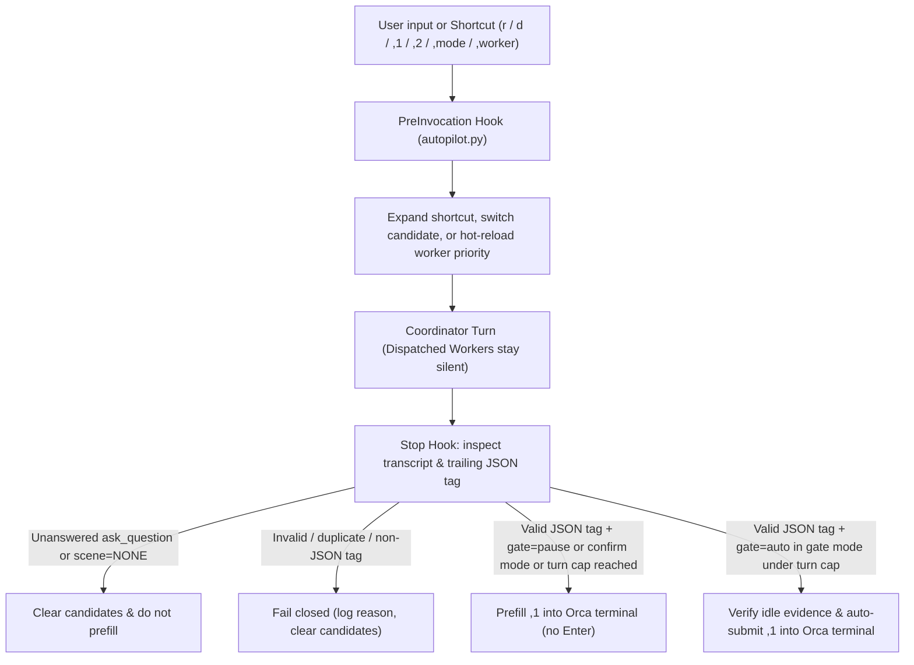

# the-pilot

[](LICENSE)
[](pyproject.toml)
[](pyproject.toml)
[](https://skills.sh/sensebeing/the-pilot)
[](https://github.com/sensebeing/the-pilot/stargazers)

**Stop working as a human relay for your coding agents.**

Distill seven days of multi-agent chat history into a four-stage Turn Autopilot, so your attention goes to product and architecture instead of prompt handoffs.

Coding agents stop after every turn. A feature or a root-cause fix moves through architecture design, isolated implementation, code review, branch integration, verification, and workspace cleanup, and each of those transitions normally ends with a person reading the summary and typing the next instruction: *"review the branch"*, *"merge to main and deploy dev"*, *"run E2E"*, *"clean up the worktree and update the docs"*, *"continue"*. The developer becomes a relay between stages of an assembly line, retyping the same handful of prompts every day. Auto-continue scripts do not fix this: they press Enter while a clarifying question is still open, or they scrape Markdown prose with regexes that break on the first backtick.

`the-pilot` takes over the routine handoffs. It distills seven days of multi-agent chat history to find the prompts you keep typing, compiles a minimal four-stage pipeline, and gives every stage an explicit deliverable and exit quality bar. Routine stages advance automatically in `gate` mode once questions are settled and the terminal is idle. Design trade-offs and production releases pause for a human (`gate=pause`), or stop while an `ask_question` tool call waits for an answer (`scene=NONE`). The runtime reads one trailing JSON tag with `json.loads` and no regex, so visible prose, backticks, and code blocks never affect the decision.

| Without `the-pilot` | With `the-pilot` |
| --- | --- |
| You act as the relay. After every turn you read the agent summary and retype the same transition prompts (*"review the branch"*, *"merge and verify"*, *"clean up the worktree"*), while naive auto-continue scripts press Enter over open clarifying questions or break on a backtick. | The four-stage pipeline owns routine transitions. Coordinator sessions design and review, Orca child workers implement on isolated branches, and a stage advances only after its deliverable and exit quality bar are met. Design decisions and production gates wait for your judgment. |

[中文文档](README.zh-CN.md) · [Quick start](#quick-start) · [Presets & 4 dimensions](#presets-and-four-dimension-customization) · [Four-scene state machine](#four-scene-state-machine) · [Workflow](#workflow) · [Project overlay](#project-extension-tier-pilotprojectjson) · [Setup skill](skills/the-pilot-setup/SKILL.md) · [Daily skill](skills/the-pilot/SKILL.md)

## Get started in 30 seconds: paste to your agent

Paste this into Antigravity, Claude Code, Codex, Cursor, or Orca:

```text
Install and set up https://github.com/sensebeing/the-pilot for my environment.
Install the CLI (`uv tool install git+https://github.com/sensebeing/the-pilot` or `python3 -m pip install git+https://github.com/sensebeing/the-pilot`),
install the skills (`npx skills add sensebeing/the-pilot --global --agent '*'` or symlink from a checkout),
then follow skills/the-pilot-setup/SKILL.md to run `pilot distill --days 7 --json`, recommend scenes and shortcuts from my recent chat history, configure the 4 dimensions, and verify pilot status.
```

## Why we built it

We built `the-pilot` because our own sessions had turned into a relay loop. A task moved from design to implementation to review to delivery, and after every turn someone typed the transition prompt. The prompts were always the same: *"review the branch"*, *"merge to main and deploy dev"*, *"run the targeted E2E"*, *"clean up the worktree and update the docs"*, *"continue"*. The human was doing procedural assembly-line work between stages that a pipeline could determine on its own.

The judgments that need a person are product decisions, architecture boundaries, and whether a design is simple enough to ship. Routine handoffs should not consume that attention.

So `the-pilot` distills seven days of chat history, turns recurring prompts into four stages with explicit deliverables and quality bars, and advances routine transitions automatically. Class A transitions, such as worker implementation to whole-task architecture review or a clean review to authorized branch integration, run in `gate` mode. Class B design and contract decisions pause (`gate=pause`) with the recommended prompt prefilled in the terminal input box, or stop (`scene=NONE`) while an `ask_question` tool call waits for an answer.

Humans read the visible `,1` and `,2` Markdown lines, which can contain inline backticks, code blocks, or symbols. The runtime parses only the trailing JSON comment (`<!-- autopilot: {...} -->`) via `json.loads`.

## How it compares to other approaches

| Approach | What it provides | Where the human still carries the load |
| --- | --- | --- |
| Static prompt and spec libraries (superpowers, spec-kit, claude-code-workflows) | Slash commands, checklists, and spec templates for common engineering steps. | You decide when each step starts and trigger every stage transition by hand. |
| Blind auto-loop wrappers (ralph-claude-code, queue auto-clickers) | A loop that keeps sending prompts until the agent exits. | Routine handoffs and architecture or production gates receive the same treatment, with no per-stage deliverable or quality bar to stop on. |
| Multi-terminal session managers (claude-squad, Prowl, sno-station) | Several agent terminals tiled in one window. | More agents in view means more windows to babysit, and the handoff prompts stay manual. |
| `the-pilot` | Seven days of multi-agent chat history distilled into a minimal four-stage pipeline, with an explicit deliverable and exit quality bar for every stage. | Routine stages advance automatically (`gate=auto`); design decisions and production releases pause for confirmation (`gate=pause`). |

## Quick start

### 1. Install

Install the `pilot` CLI with Python 3.11+ on macOS or Linux (`fcntl` file locking):

```sh
uv tool install git+https://github.com/sensebeing/the-pilot
# or with pip:
python3 -m pip install git+https://github.com/sensebeing/the-pilot
```

Install the agent skills (`$the-pilot` and `$the-pilot-setup`) for Antigravity, Claude Code, Codex, Cursor, Gemini CLI, GitHub Copilot, or Windsurf:

```sh
npx skills add sensebeing/the-pilot --global --agent '*'
```

In Claude Code, you can also install via the plugin marketplace:

```text
/plugin marketplace add sensebeing/the-pilot
/plugin install the-pilot@the-pilot
```

The CLI has no external runtime dependencies. Terminal prefill and auto-submission use Orca and an Antigravity-compatible lifecycle Hook host (`PreInvocation` and `Stop`).

### 2. Initialize

```sh
pilot probe --no-project --json
pilot distill --days 7 --json
pilot apply --no-project --preset recommended --json
pilot status --json
```

`pilot distill --days 7 --json` scans the last 7 days of local agent conversations (Antigravity, Claude Code, Codex, and Cursor) to surface recurring manual prompts and suggest scenes, guardrails, and shortcuts before you apply a profile.

If your repository has a project overlay at `<repo>/.pilot/project.json`, bind it during apply:

```sh
pilot apply --project /path/to/repo --preset recommended --json
```

Installing the Python package does not modify user files on its own. Running `pilot apply` writes the managed runtime, scene files, `GEMINI.md` profile block, and Hook group.

### 3. Switch modes or executors in chat

Inside an active chat session or from the terminal:

```sh
# In chat (handled by the PreInvocation hook):
,mode gate          # Auto-submit when gate=auto (up to turn cap); prefill when gate=pause
,mode confirm       # Always prefill without pressing Enter
,mode off           # Disable end-of-turn prefill
,worker codex       # Prefer Codex > Claude Code for Orca workers (hot-reloads next turn)
,1                  # Run primary suggestion (or `,1 <extra instructions>`)
,2                  # Switch to alternative suggestion `,2`
```

## Presets and four-dimension customization

### Built-in presets

| Preset | Autopilot mode | Max auto turns | Enabled scenes | Delivery strategy | Default shortcuts | Best fit |
| --- | --- | --- | --- | --- | --- | --- |
| `recommended` | `gate` | `8` | All 4 scenes | `merge_dev_e2e` | `r`, `rt`, `d`, `pull` (+ project overlay) | Recommended default: advances automatically across routine engineering stages and pauses on design decisions or prod gates. |
| `conservative` | `confirm` | `4` | All 4 scenes | `merge_dev_e2e` | `r`, `rt`, `d`, `pull` (+ project overlay) | Human-in-the-loop: prefills the next prompt at the end of each turn and waits for you to press Enter. |
| `orchestration-only` | `off` | `4` | None (`[]`) | `merge_dev_e2e` | None (`[]`) | Coordinator/Worker rules only: installs Orca orchestration governance without end-of-turn prefill. |

### Four customization dimensions (`orca-autopilot-profile/v1`)

| Dimension | Profile keys | Supported values and defaults | What it governs |
| --- | --- | --- | --- |
| 1. Orchestration | `worker_agents`<br>`review_agents` | Workers: `["codex", "claude"]` or `["claude", "codex"]`<br>Reviewers: `["codex", "claude", "agy"]` | Coordinator and Dispatched Worker separation, child-worktree isolation, branch-first review loop, and hot-reloadable executor priority. |
| 2. Autopilot | `mode`<br>`max_consecutive_auto_turns` | Mode: `gate` \| `confirm` \| `off`<br>Turn cap: `1..50` (default `8`) | Whether `gate=auto` turns submit automatically or fall back to prefill once consecutive auto turns hit the cap. |
| 3. Scenes | `enabled_scenes`<br>`deliver_strategy`<br>`enable_feedback_email`<br>`guardrails` | Strategies: `merge_dev_e2e` \| `merge_dev_only` \| `local_verify_only`<br>Feedback email: `false` \| `true` | Which of the 4 scenes are active, what delivery steps are generated, and custom per-scene quality guardrails. |
| 4. Shortcuts | `enabled_entry`<br>`custom_entry`<br>`custom_comma`<br>`template_overrides` | Universal entries: `r`, `rt`, `d`, `pull`<br>Plus project entries and custom aliases | Short prompt templates expanded deterministically on `PreInvocation` (for example, `r auth` expands into a full architectural review prompt). |

## Four-scene state machine

At the end of each Coordinator turn, the model classifies the task (`Class A` deterministic convergence vs. `Class B` design or contract decision), routes to one of four orthogonal scenes (or `NONE`), prints visible `,1` / `,2` suggestions in Markdown, and emits a single trailing JSON tag:

```html
<!-- autopilot: {"scene": "plan-and-orchestrate", "gate": "auto", "1": "Primary prompt", "2": "Alternative prompt"} -->
```

Every stage carries a deliverable and an exit quality bar, and the runtime advances only when that obligation is met. A turn cannot jump from implementation to delivery without the whole-task architecture re-review, and a task cannot be declared done before closeout is settled.

| Scene | When it triggers | Default gate | Deliverable | Exit quality bar | Next-step responsibility |
| --- | --- | --- | --- | --- | --- |
| `plan-and-orchestrate` | Initial architecture review, new feature design, root-cause diagnosis, or a review remediation list is ready for code changes. | `auto` (`Class A`)<br>`pause` (`Class B`) | An agreed whole-task plan: unique owner, boundaries, contracts, and executable orchestration tasks. | The plan covers the real root cause, the direct call topology, and the verification path, and satisfies the engineering quality rules. | Converge on root-cause architecture and dispatch or supervise Orca child workers against explicit module contracts. |
| `architecture-re-review` | Any code in the task scope was implemented or modified during the turn, even if already merged. | `auto` | A whole-task architecture review of all implementation in the task, with unresolved issues recorded. | Unique owner, responsibility boundaries, contracts, and uncovered risks are closed. | Audit the entire task scope against original design docs and simplest-architecture standards before delivery. |
| `deliver-and-verify` | Whole-task architecture and engineering quality issues are zero, and authorized delivery or verification steps remain. | `auto` (pauses before `/ship` prod) | Authorized integration, environment verification, and the targeted real-run evidence this change needs. | Every delivery action has verification results matched to the change, remaining risks, and traceable evidence. | Merge to `main` and complete the configured delivery strategy (`merge_dev_e2e`, `merge_dev_only`, or `local_verify_only`). |
| `closeout-and-sync` | Code review and delivery verification are complete, with docs, ledgers, feedback, alerts, or worktrees left to close out. | `auto` | Required docs synced, authorized obligations settled, and reclaimable collaboration resources released. | The closeout record matches actual state, unfinished obligations have an owner, and the task is declared done only after everything is settled. | Sync docs and ledgers, release Orca workers (`worker-release`), clean up session worktrees, and land closeout commits. |
| `NONE` | Waiting on `ask_question` user input, or every code, delivery, and closeout obligation is complete. | No prefill | Nothing left to do. | Every obligation is settled. | Emit `<!-- autopilot: {"scene": "NONE"} -->` and stop cleanly. |

`pilot distill --days 7 --json` audits both the recurring prompt patterns and the end-to-end health of the installed pipeline. It reports stage completeness, per-stage deliverables and quality bars, whether review and closeout handoffs happen before and after delivery, and whether custom scenes or guardrails add machinery without independent value.

The default `merge_dev_e2e` strategy runs targeted dev E2E after deployment. If unnecessary or prerequisites are unavailable, report the concrete reason and remaining risk, then close out. Prod and full/batch suites still require explicit current-turn authorization. Select `merge_dev_only` explicitly for deployment verification only.

## Workflow



1. The runtime locates the trailing `<!-- autopilot: ... -->` comment with a JSON-string-aware delimiter scanner and parses the payload with `json.loads`. Literal Markdown formatting (backticks, `**`, `<!--...-->`, `-->`, newlines, and colons) inside JSON strings is preserved as-is.
2. Before acting on any `Stop` event, `autopilot.py` reads the conversation transcript (hydrating truncated steps from `transcript_full.jsonl` when needed) to verify that every synchronous or asynchronous question tool call (`ask_question`, `AskUserQuestion`, `request_user_input`) was answered in the same turn.
3. Before sending keystrokes to Orca, the runtime records a `pending` delivery reservation under an exclusive `fcntl` lock. If `orca terminal send` times out or returns an unknown status, the session freezes automatic delivery until manual user input or explicit `,autopilot recover`, avoiding duplicate submissions.

## Where it fits

| Tool | Responsibility | How `the-pilot` interacts with it |
| --- | --- | --- |
| Orca (`orca` CLI) | Worktrees, terminal multiplexing, and supervised Coordinator/Worker runs. | Dispatches workers, verifies terminal idle state, and delivers prefill or auto-submit keystrokes to the bound session terminal. |
| [the-guard](https://github.com/sensebeing/the-guard) | Repository architecture policies, static topology ratchets, and independent pre-merge review. | Drives the `architecture-re-review` loop so Coordinator sessions audit whole-task changes before advancing to delivery. |
| [the-dealer](https://github.com/sensebeing/the-dealer) | Same-machine and cross-team encrypted P2P task dispatch. | Project overlays can register Dealer wave shortcuts (`dl`, `dls`, `dla`) while keeping network transport out of `the-pilot`. |

## Project extension tier (`.pilot/project.json`)

Universal mode stays project-neutral (`r`, `rt`, `d`, `pull`). Repositories can add domain-specific shortcuts, presets, delivery copy, and closeout instructions by placing `.pilot/project.json` (`schema: "the-pilot-project/v1"`) at the repository root (see [examples/project.example.json](examples/project.example.json)):

```json
{
  "schema": "the-pilot-project/v1",
  "projectId": "example",
  "description": "A project-specific closeout instruction.",
  "scene_specs": {
    "closeout-and-sync": {
      "fallback_prompt": "Update project documentation and release owned resources."
    }
  }
}
```

```sh
pilot apply --project /path/to/repo --preset recommended --json
pilot apply --upgrade --json       # Recompiles engine and artifacts while preserving installed project overlay
pilot apply --no-project --json    # Switches back to universal project-neutral defaults
```

Overlay discovery checks explicit `--no-project`, then explicit `--project <repo-or-json>`, then the installed `project.json` copy, then the nearest cwd ancestor `.pilot/project.json`, and finally universal defaults. Unknown schema keys fail closed, every new entry shortcut must appear in `entry_order` with a unique command identity, and built-in scene filenames remain fixed inside the managed scene directory.

## CLI reference

| Command | Purpose |
| --- | --- |
| `pilot probe [--project <repo> \| --no-project] --json` | Read-only discovery of installed profile, project overlay, and available agent CLIs (`codex`, `claude`, `agy`). |
| `pilot distill [--days 7] [--max-sessions 80] --json` | Read-only distillation of recent local agent chat logs (`antigravity`, `claude`, `codex`, `cursor`) into recurring prompt patterns and automation suggestions. |
| `pilot apply [--preset <name>] [--project <repo>] [--profile <json>] [--upgrade] --json` | Compile and atomically install `autopilot.py`, `config.json`, `scenes/*.md`, `GEMINI.md` block, and Hook group. |
| `pilot status [--project <repo>] --json` | Verify installation health, active mode, worker priority, and byte-level artifact drift (`drift: []`). |
| `pilot uninstall --json` | Remove managed files, `GEMINI.md` managed block, and Hook entries while preserving unrelated user config. |
| `pilot mode [status\|gate\|confirm\|off]` | Inspect or switch Turn Autopilot mode (`gate`, `confirm`, `off`). |
| `pilot worker [status\|codex\|claude\|cc]` | Inspect or persist worker priority (`codex > claude` vs. `claude > codex`) and schedule next-turn hot reload. |
| `pilot sync` | Re-sync the `GEMINI.md` scene block after editing installed `scenes/*.md` files. |
| `pilot set <shortcut> <template>` | Persist a custom shortcut template override in `profile.json` and recompile `config.json`. |
| `pilot log [--lines <n>]` | Inspect structured runtime delivery events from `state/autopilot.log`. |
| `pilot hook --event <PreInvocation\|Stop>` | Lifecycle Hook entrypoint invoked by the host agent runtime. |

Installer commands accept `--gemini-dir <path>`; runtime commands read `ORCA_AUTOPILOT_GEMINI_DIR`.

## Development

`the-pilot` uses [the-guard](https://github.com/sensebeing/the-guard) to enforce unidirectional module imports (`cli -> installer -> compiler -> profile -> project -> defaults`), a standalone runtime asset (`assets/autopilot.py`), and zero `re` imports:

```sh
PYTHONPATH=src python3 -m unittest discover -s tests -v
guard topology sync --repo-root .
guard check --repo-root . --base origin/main
guard review --repo-root .
```

See [src/the_pilot/README.md](src/the_pilot/README.md) for package structure and module boundaries, [Contributing](CONTRIBUTING.md) for setup and review requirements, [Security](SECURITY.md) for vulnerability reporting, and [Changelog](CHANGELOG.md) for release history.

## Related projects

`the-pilot` is part of the SenseBeing open-source toolkit for AI-native engineering teams:

| Project | What it does |
| --- | --- |
| [the-guard](https://github.com/sensebeing/the-guard) | Architecture guardrails, deterministic topology ratchets, and independent pre-merge agent review. |
| [the-dealer](https://github.com/sensebeing/the-dealer) | Same-machine multi-agent dispatch and encrypted P2P task collaboration across machines and teams. |

If `the-pilot` helps your team build with AI, a star on GitHub helps other teams find it.

## License

[MIT](LICENSE)
