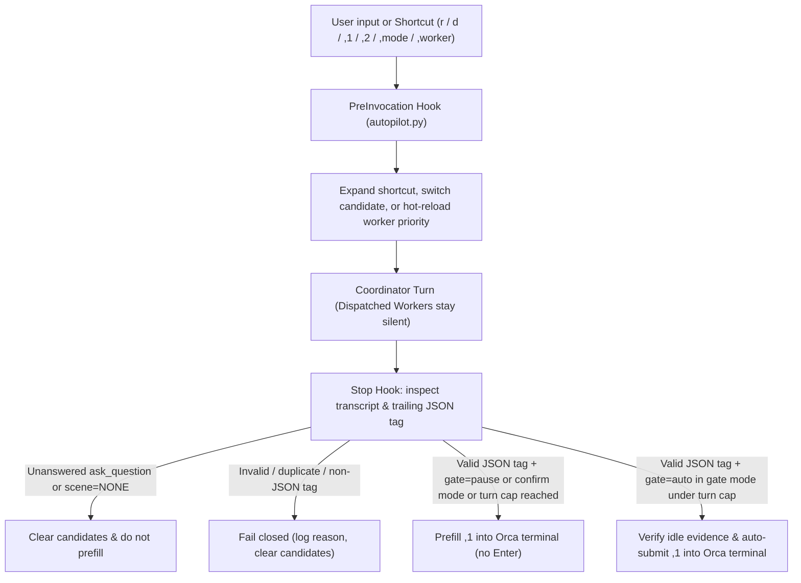

# the-pilot

[](LICENSE)
[](pyproject.toml)
[](pyproject.toml)

**Keep your AI coding sessions moving—safely, autonomously, and on architecture.**

Scene-based Turn Autopilot and Orca Coordinator/Worker governance for AI-native engineering teams.

Long-running engineering tasks rarely finish in a single prompt. A real feature or root-cause fix moves through architecture design, isolated worker implementation, merciless code review, main-branch integration, verification, and workspace closeout. Without turn automation, sessions constantly stall waiting for a human to type *"now review the branch"*, *"now merge and verify"*, or *"now clean up the worktree"*. Naive auto-continue scripts fail in the opposite direction—blindly pressing Enter while a clarifying question is still unanswered, or scraping Markdown prose with brittle regular expressions.

`the-pilot` turns every completed agent turn into a deterministic, scene-aware next step—separating Coordinator design from Worker implementation, reading a single trailing structured JSON tag (`json.loads`, zero regex), and mechanically gating terminal delivery on settled questions, turn caps, and session locks.

[中文文档](README.zh-CN.md) · [Quick start](#quick-start) · [Presets & 4 dimensions](#presets-and-four-dimension-customization) · [Four-scene state machine](#four-scene-state-machine) · [Workflow](#workflow) · [Project overlay](#project-extension-tier-pilotprojectjson) · [Setup skill](skills/the-pilot-setup/SKILL.md) · [Daily skill](skills/the-pilot/SKILL.md)

## Get started in 30 seconds — paste to your agent

Paste this into Antigravity, Claude Code, Codex, or Orca:

```text
Set up the-pilot while preserving my existing configuration and hooks.

1. Check `python3 --version` (require Python >= 3.11) and `command -v pilot`.
   If `pilot` is not installed, clone https://github.com/sensebeing/the-pilot.git into ~/the-pilot
   (or update an existing checkout with `git -C ~/the-pilot pull --ff-only`), then install it with
   `python3 -m pip install -e ~/the-pilot` (or use `~/the-pilot/bin/pilot`).
2. Register the skills by symlinking `~/the-pilot/skills/the-pilot` and
   `~/the-pilot/skills/the-pilot-setup` into `~/.agents/skills/`, `~/.claude/skills/`,
   and `~/.gemini/config/skills/` if present, preserving existing files.
   Read `~/the-pilot/skills/the-pilot-setup/SKILL.md`.
3. Run `pilot probe --json` (add `--project <repo>` if this repository has `.pilot/project.json`)
   to inspect existing preferences and local agent CLIs (`codex`, `claude`, `agy`).
4. Ask me about the 4 customization dimensions (with recommended defaults first):
   - Orchestration executor & review priority (`codex > claude` or `claude > codex`)
   - Turn Autopilot mode (`gate`, `confirm`, or `off`) and max consecutive auto turns
   - Enabled scenes, delivery strategy (`merge_dev_only`, `merge_dev_e2e`, `local_verify_only`), and guardrails
   - Entry shortcuts (`r`, `rt`, `d`, `pull`, project shortcuts) and custom comma aliases
5. Apply my confirmed preferences with `pilot apply`, verify `pilot status --json` reports
   `drift: []`, and give me a personalized daily cheatsheet.
```

If `pilot` is already installed elsewhere, locate its source checkout (or clone it to `~/the-pilot`) for the skills in step 2. With the direct launcher, substitute `~/the-pilot/bin/pilot` for `pilot` below.

## Why we built it

When our team builds software in Orca, a single task often spans a Coordinator session designing the architecture and reviewing diffs, plus one or more Codex or Claude Code workers implementing changes on isolated child worktrees.

We wanted our sessions to drive multi-stage tasks from root-cause analysis all the way to clean branch landing without human babysitting on routine transitions—while **never** compromising safety boundaries:
- **Deterministic routine transitions (`Class A`)**—like moving from implementation to whole-task architecture review, or from a passed review to authorized branch integration—should advance automatically in `gate` mode.
- **Architectural trade-offs and unconfirmed boundaries (`Class B`)** must pause (`gate=pause`) with the recommended next step prefilled in the terminal input box, or stop completely (`scene=NONE`) while an `ask_question` tool call awaits the user's answer.
- **Presentation must never break execution**: humans read rich Markdown suggestions (`,1` / `,2` with inline code backticks or symbols), while the runtime parses only the trailing structured JSON comment (`<!-- autopilot: {...} -->`) via `json.loads` with zero regular expressions.

## Quick start

### 1. Install

With Python 3.11+ on macOS or Linux (`fcntl` file locking):

```sh
python3 -m pip install /path/to/the-pilot
```

Or run `/path/to/the-pilot/bin/pilot` directly from a checkout. The package has **zero external runtime dependencies**; actual terminal prefill and auto-submission use Orca and an Antigravity-compatible lifecycle Hook host (`PreInvocation` and `Stop`).

### 2. Initialize in 30 seconds

```sh
pilot probe --no-project --json
pilot apply --no-project --preset recommended --json
pilot status --json
```

If your repository defines a project overlay at `<repo>/.pilot/project.json`, bind it during apply:

```sh
pilot apply --project /path/to/repo --preset recommended --json
```

Package installation never mutates user files on its own—only an explicit `pilot apply` writes the managed runtime, scene files, `GEMINI.md` profile block, and Hook group.

### 3. Switch modes or executors anytime

Inside an active chat session or from the terminal:

```sh
# In chat (handled by PreInvocation hook):
,mode gate          # Auto-submit when gate=auto (up to turn cap); prefill when gate=pause
,mode confirm       # Always prefill without pressing Enter
,mode off           # Disable end-of-turn prefill
,worker codex       # Prefer Codex > Claude Code for Orca workers (hot-reloads next turn)
,1                  # Run primary suggestion (or `,1 <extra instructions>`)
,2                  # Switch to alternative suggestion `,2`
```

## Presets and four-dimension customization

### Built-in presets

| Preset | Autopilot mode | Max auto turns | Enabled scenes | Delivery strategy | Default shortcuts | Best fit |
| --- | --- | --- | --- | --- | --- | --- |
| `recommended` | `gate` | `8` | All 4 scenes | `merge_dev_only` | `r`, `rt`, `d`, `pull` (+ project overlay) | **Recommended default** — automatic flow across deterministic engineering stages, pausing on design decisions or prod gates. |
| `conservative` | `confirm` | `4` | All 4 scenes | `merge_dev_only` | `r`, `rt`, `d`, `pull` (+ project overlay) | **Human-in-the-loop** — prefills the next prompt at the end of each turn, always waiting for you to press Enter. |
| `orchestration-only` | `off` | `4` | None (`[]`) | `merge_dev_only` | None (`[]`) | **Coordinator/Worker rules only** — installs Orca orchestration governance without end-of-turn prefill. |

### Four customization dimensions (`orca-autopilot-profile/v1`)

| Dimension | Profile keys | Supported values & defaults | What it governs |
| --- | --- | --- | --- |
| **1. Orchestration** | `worker_priority`<br>`review_priority` | Workers: `["codex", "claude"]` or `["claude", "codex"]`<br>Reviewers: `["codex", "claude", "agy"]` | Coordinator vs. Dispatched Worker separation, child-worktree isolation, branch-first review loop, and hot-reloadable executor priority. |
| **2. Autopilot** | `mode`<br>`max_consecutive_auto_turns` | Mode: `gate` \| `confirm` \| `off`<br>Turn cap: `1..20` (default `8`) | Whether `gate=auto` turns submit automatically or fall back to prefill once consecutive auto turns hit the cap. |
| **3. Scenes** | `enabled_scenes`<br>`deliver_strategy`<br>`enable_feedback_email`<br>`custom_guardrails` | Strategies: `merge_dev_only` \| `merge_dev_e2e` \| `local_verify_only`<br>Feedback email: `false` \| `true` | Which of the 4 scenes are active, what delivery steps are generated, and custom per-scene quality guardrails. |
| **4. Shortcuts** | `enabled_entry`<br>`custom_entry`<br>`custom_comma`<br>`template_overrides` | Universal entries: `r`, `rt`, `d`, `pull`<br>Plus project entries & custom aliases | Short prompt templates expanded deterministically on `PreInvocation` (e.g., `r auth` → full architectural review prompt). |

## Four-scene state machine

At the end of every Coordinator turn, the model classifies the task (`Class A` deterministic convergence vs. `Class B` design/contract decision), routes to one of four orthogonal scenes (or `NONE`), prints visible `,1` / `,2` suggestions in Markdown, and emits a single trailing JSON tag:

```html
<!-- autopilot: {"scene": "plan-and-orchestrate", "gate": "auto", "1": "Primary prompt", "2": "Alternative prompt"} -->
```

| Scene | When it triggers | Default gate | Next-step responsibility |
| --- | --- | --- | --- |
| `plan-and-orchestrate` | Initial architecture review, new feature design, root-cause diagnosis, or review remediation list is ready for code changes. | `auto` (`Class A`)<br>`pause` (`Class B`) | Converge on root-cause architecture and dispatch/supervise Orca child workers against explicit module contracts. |
| `architecture-re-review` | Any code in the task scope was implemented or modified during the turn (even if already merged). | `auto` | Audit the entire task scope against original design docs and simplest-architecture standards before delivery. |
| `deliver-and-verify` | Whole-task architecture and engineering quality issues are zero, and authorized delivery/verification steps remain. | `auto` (pauses before `/ship` prod) | Merge to `main` and complete the configured delivery strategy (`merge_dev_only`, `merge_dev_e2e`, or `local_verify_only`). |
| `closeout-and-sync` | Code review and delivery verification are complete, with docs, ledgers, feedback/alerts, or worktrees left to close out. | `auto` | Sync docs/ledgers, release Orca workers (`worker-release`), clean up session worktrees, and land closeout commits. |
| `NONE` | Waiting on `ask_question` user input, or every code, delivery, and closeout obligation is 100% complete. | No prefill | Emit `<!-- autopilot: {"scene": "NONE"} -->` and stop cleanly. |

## Workflow



1. **Single structured truth, zero regex**: The engine locates the trailing `<!-- autopilot: ... -->` comment with a JSON-string-aware delimiter scanner and parses the payload exclusively via `json.loads`. Literal Markdown formatting (backticks, `**`, `<!--...-->`, `-->`, newlines, colons) inside JSON strings survives untouched.
2. **Question settlement protection**: Before acting on any `Stop` event, `autopilot.py` inspects the conversation transcript (hydrating truncated steps from `transcript_full.jsonl` when needed) to verify that every synchronous or asynchronous question tool call (`ask_question`, `AskUserQuestion`, `request_user_input`) has been answered in the same turn.
3. **Ambiguous delivery lock**: Before sending keystrokes to Orca, the runtime records a `pending` delivery reservation under an exclusive `fcntl` lock. If `orca terminal send` times out or returns an unknown state, the session freezes automatic delivery until manual user input or explicit `,autopilot recover`—never blindly replaying a potentially delivered prompt.

## Where it fits

`the-pilot` works alongside your multi-agent and engineering quality stack:

| Tool | Responsibility | How `the-pilot` interacts with it |
| --- | --- | --- |
| **Orca** (`orca` CLI) | Worktrees, terminal multiplexing, and supervised Coordinator/Worker runs. | Dispatches workers, verifies terminal idle state, and delivers prefill/auto-submit keystrokes to the bound session terminal. |
| **[the-guard](https://github.com/sensebeing/the-guard)** | Repository architecture policies, static topology ratchets, and independent pre-merge review. | Drives the `architecture-re-review` loop so Coordinator sessions audit whole-task changes before advancing to delivery. |
| **The Dealer** (`dealer` CLI) | Same-machine and cross-team encrypted P2P task dispatch. | Project overlays can register Dealer wave shortcuts (`dl`, `dls`, `dla`) while keeping network transport out of `the-pilot`. |

## Project extension tier (`.pilot/project.json`)

 Universal mode stays project-neutral (`r`, `rt`, `d`, `pull`). Repositories can layer domain-specific shortcuts, presets, delivery copy, and closeout instructions by placing `.pilot/project.json` (`schema: "the-pilot-project/v1"`) at the repo root (see [examples/project.example.json](examples/project.example.json)):

```json
{
  "schema": "the-pilot-project/v1",
  "projectId": "example",
  "description": "A project-specific closeout instruction.",
  "scene_specs": {
    "closeout-and-sync": {
      "fallback_prompt": "Update project documentation and release owned resources."
    }
  }
}
```

```sh
pilot apply --project /path/to/repo --preset recommended --json
pilot apply --upgrade --json       # Recompiles engine & artifacts while preserving installed project overlay
pilot apply --no-project --json    # Switches back to universal project-neutral defaults
```

- **Overlay discovery order**: Explicit `--no-project` → explicit `--project <repo-or-json>` → installed `project.json` copy → nearest cwd ancestor `.pilot/project.json` → universal defaults.
- **Strict validation**: Unknown schema keys fail closed, every new entry shortcut must appear in `entry_order` with a unique command identity, and built-in scene filenames remain fixed inside the managed scene directory.

## CLI reference

| Command | Purpose |
| --- | --- |
| `pilot probe [--project <repo> \| --no-project] --json` | Read-only discovery of installed profile, project overlay, and available agent CLIs (`codex`, `claude`, `agy`). |
| `pilot apply [--preset <name>] [--project <repo>] [--profile <json>] [--upgrade] --json` | Pure compilation and atomic installation of `autopilot.py`, `config.json`, `scenes/*.md`, `GEMINI.md` block, and Hook group. |
| `pilot status [--project <repo>] --json` | Verify installation health, active mode, worker priority, and byte-level artifact drift (`drift: []`). |
| `pilot uninstall --json` | Cleanly remove managed files, `GEMINI.md` managed block, and Hook entries while preserving unrelated user config. |
| `pilot mode [status\|gate\|confirm\|off]` | Inspect or switch Turn Autopilot mode (`gate`, `confirm`, `off`). |
| `pilot worker [status\|codex\|claude\|cc]` | Inspect or persist worker priority (`codex > claude` vs. `claude > codex`) and schedule next-turn hot reload. |
| `pilot sync` | Re-sync the `GEMINI.md` scene block after editing installed `scenes/*.md` files. |
| `pilot set <shortcut> <template>` | Persist a custom shortcut template override in `profile.json` and recompile `config.json`. |
| `pilot log [--lines <n>]` | Inspect structured runtime delivery events from `state/autopilot.log`. |
| `pilot hook --event <PreInvocation\|Stop>` | Lifecycle Hook entrypoint invoked by the host agent runtime. |

Installer commands accept `--gemini-dir <path>`; runtime commands honor `ORCA_AUTOPILOT_GEMINI_DIR`.

## Development

`the-pilot` is guarded by [the-guard](https://github.com/sensebeing/the-guard) with unidirectional module topology (`cli -> installer -> compiler -> profile -> project -> defaults`, isolated runtime asset `assets/autopilot.py`, and zero `re` imports):

```sh
PYTHONPATH=src python3 -m unittest discover -s tests -v
guard check --repo-root . --base origin/main
guard review --repo-root .
```

See [src/the_pilot/README.md](src/the_pilot/README.md) for internal package architecture and module boundaries.

See [Contributing](CONTRIBUTING.md) for setup and review requirements, [Security](SECURITY.md) for private vulnerability reporting, and [Changelog](CHANGELOG.md) for release history.

## License

[MIT](LICENSE)
