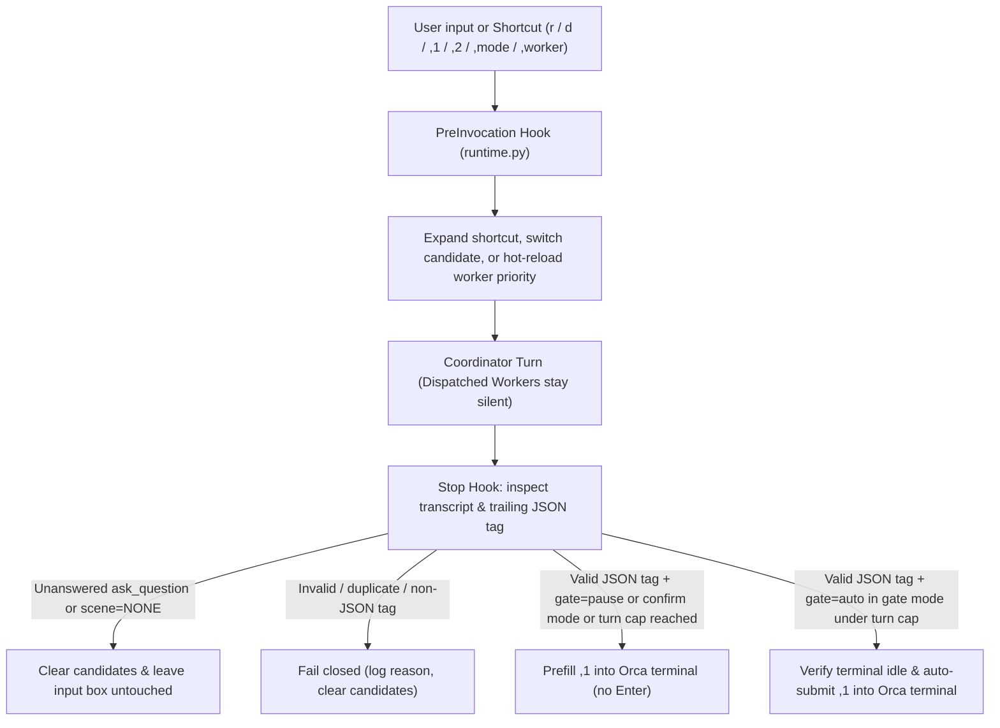

# the-pilot

[](LICENSE)
[](pyproject.toml)
[](pyproject.toml)
[](https://skills.sh/sensebeing/the-pilot)
[](https://github.com/sensebeing/the-pilot/stargazers)

**Turn Pilot for coding agents: prefill the next prompt, auto-advance routine steps, pause for product and architecture decisions, and expand short commands.**

When you work with coding agents, most turns end the same way: you read the summary and type the next transition prompt by hand (*"review the branch"*, *"merge to main and deploy dev"*, *"run E2E"*, *"clean up the worktree and update docs"*). `the-pilot` handles those transitions inside your terminal so your attention stays on product and engineering decisions.

[中文文档](README.zh-CN.md) · [What it does](#what-it-does) · [How it works](#how-it-works-scene-based-judgment) · [Quick start](#quick-start) · [Presets & 4 dimensions](#presets-and-four-dimension-customization) · [Project overlay](#project-extension-tier-pilotprojectjson) · [CLI reference](#cli-reference)

---

## What it does

`the-pilot` does four concrete things in your agent terminal:

### 1. Prefills the next prompt into your input box

At the end of every turn, the agent prints a primary next step (`,1`) and an alternative (`,2`), and `the-pilot` automatically types `,1` into your terminal input box:

```text
Next step suggestions:
- ,1 (Primary): Merge to main, deploy dev, and run targeted E2E verification
- ,2 (Alternative): Merge to main and deploy dev only, skip E2E for now

> Merge to main, deploy dev, and run targeted E2E verification█
```

- Press **`Enter`** to send the prefilled prompt as-is.
- Type **`,2`** to send the alternative option instead.
- Type **`,1 also check migration 790`** to append extra instructions to the primary prompt.

### 2. Auto-submits routine pipeline steps

In `gate` mode, routine engineering transitions do not wait for you to press `Enter`. Once the terminal is idle and no questions are open, `the-pilot` submits `,1` automatically:

- **Implementation finished** → automatically starts a whole-task architecture & code review.
- **Review passed with zero issues** → automatically merges to `main`, deploys to `dev`, and runs targeted verification.
- **Verification passed** → automatically syncs docs, releases Orca child workers, and cleans up session worktrees.

A configurable consecutive turn cap (default `8`) falls back to prefill-only if a task loops too many times.

### 3. Pauses and waits on product and engineering judgments

`the-pilot` never auto-presses `Enter` when a human decision is needed:

- **Architecture & product trade-offs (`gate=pause`)**: When a turn proposes a new feature design, changes a module contract, or asks you to choose between approaches, `the-pilot` prefills the recommended prompt into the input box and **stops without pressing `Enter`**.
- **Production release gates (`gate=pause`)**: Before `/ship` or production deployment, it always pauses for human confirmation.
- **Open clarifying questions (`scene=NONE`)**: If the agent calls `ask_question` / `AskUserQuestion` and is waiting for your answer, or if the entire task is finished, `the-pilot` leaves your input box completely untouched.

### 4. Expands short commands in the chat box

Type short aliases directly into the chat input box; the `PreInvocation` hook expands them before the turn starts:

| Shortcut | What it does |
| --- | --- |
| `r [scope]` | Expands into a full architecture & code quality review prompt for `[scope]`. |
| `rt [scope]` | Reviews `[scope]` and immediately orchestrates fixes for any findings. |
| `d [requirement]` | Designs a root-cause architecture plan and dispatches an isolated Orca worker. |
| `pull` | Fast-forwards local `main` safely without touching dirty worktrees. |
| `,mode gate\|confirm\|off` | Switches between auto-submit (`gate`), prefill-only (`confirm`), and disabled (`off`). |
| `,worker codex\|claude` | Switches Orca child-worker priority (`Codex > Claude Code` or `Claude Code > Codex`) and hot-reloads on the next turn. |

---

## How it works: scene-based judgment

Naive auto-continue scripts fail because they either press `Enter` blindly on every turn or scrape Markdown prose with regular expressions that break on the first backtick. `the-pilot` works by combining **scene-based judgment in the agent** with **deterministic Hook verification in the runtime**.

### Step 1: Distill your last 7 days of chat history (`pilot distill`)

During setup, `pilot distill --days 7 --json` scans your recent local sessions across Antigravity, Claude Code, Codex, and Cursor. It filters out machine dispatch noise, finds the prompts you actually type by hand over and over, checks where your workflow stalls, and recommends scenes, guardrails, and shortcuts tailored to your habits.

### Step 2: Classify the decision and route to one of 4 scenes

At the end of each Coordinator turn (child worker sessions stay silent), the agent evaluates what just happened in three steps:

1. **Decision boundary classification (`Class A` vs. `Class B`)**:
   - **Class A (`gate=auto`)**: The behavioral contract and boundaries are already settled (for example: reviewing code that a worker just finished, fixing a known root cause within existing module boundaries, or merging and verifying an approved change).
   - **Class B (`gate=pause`)**: A 0-to-1 design choice, an unconfirmed contract or state-machine change, or a production release gate.
   - **Wait / Done (`scene=NONE`)**: An `ask_question` tool call is still waiting for the user's answer, or all code, verification, and closeout obligations are complete.
2. **Four-scene routing with explicit deliverables and exit quality bars**:

| Scene | When it triggers | Default gate | Deliverable | Exit quality bar |
| --- | --- | --- | --- | --- |
| `plan-and-orchestrate` | Initial review report, new feature design, root-cause diagnosis, or review fix list is ready for code changes. | `auto` (Class A)<br>`pause` (Class B) | Agreed whole-task plan: unique owner, module boundaries, contracts, and orchestration tasks. | Covers the real root cause, call topology, and verification path without surface patches. |
| `architecture-re-review` | Any code in the task scope was implemented or modified during the turn (even if already merged). | `auto` | Whole-task architecture review of all code touched in the task, with any issues listed. | Unique owner, boundaries, contracts, and uncovered risks are all resolved. |
| `deliver-and-verify` | Architecture and engineering quality issues are zero, and branch merge, `dev` deploy, or E2E verification remains. | `auto` (pauses before prod `/ship`) | Authorized branch integration, environment deployment, and targeted verification evidence. | Every delivery step has matching verification results and explicit remaining-risk notes. |
| `closeout-and-sync` | Review and delivery verification are done; docs, ledgers, alerts/feedback, or Orca worktrees remain. | `auto` | Docs synced, authorized obligations closed, and child workers/worktrees released. | Repository state is clean on `origin/main` and no orphan workers or worktrees remain. |
| `NONE` | Waiting on `ask_question` user input, or all code, delivery, and closeout steps are finished. | No prefill | Nothing left to run. | All obligations settled. |

3. **Structured trailing JSON tag (zero regex)**:
   - Visible `,1` and `,2` lines are written in normal Markdown for you to read (inline backticks, code blocks, and symbols are unrestricted).
   - At the end of the reply, the agent outputs one HTML comment parsed strictly with `json.loads`:

```html
<!-- pilot: {"scene": "deliver-and-verify", "gate": "auto", "1": "Merge to main, deploy dev, and run targeted E2E", "2": "Merge to main and deploy dev only"} -->
```

### Step 3: Hook verification and terminal delivery (`runtime.py`)



1. **Transcript question check**: On `Stop`, `runtime.py` inspects the conversation transcript (hydrating truncated lines from `transcript_full.jsonl` when needed) to verify that every `ask_question`, `AskUserQuestion`, or `request_user_input` call in the turn has been answered before allowing any prefill or auto-submit.
2. **JSON-string-aware tag parser**: Locates the trailing `<!-- pilot: ... -->` block without regular expressions and parses it via `json.loads`. Missing, duplicate, or malformed tags fail closed.
3. **Idempotent terminal delivery**: Records a `pending` reservation under an exclusive `fcntl` file lock before calling `orca terminal send`. If terminal delivery times out or returns an ambiguous state, auto-submit freezes until you type a message or run `,pilot recover`, preventing duplicate submissions.

---

## Quick start

### Paste to your agent (30 seconds)

Paste this into Antigravity, Claude Code, Codex, Cursor, or Orca:

```text
Install and set up https://github.com/sensebeing/the-pilot for my environment.
Install the CLI (`uv tool install git+https://github.com/sensebeing/the-pilot` or `python3 -m pip install git+https://github.com/sensebeing/the-pilot`),
install the skills (`npx skills add sensebeing/the-pilot --global --agent '*'` or symlink from a checkout),
then follow skills/the-pilot-setup/SKILL.md to run `pilot distill --days 7 --json`, recommend scenes and shortcuts from my recent chat history, configure the 4 dimensions, and verify pilot status.
```

### Manual install & initialization

1. **Install the CLI** (Python 3.11+, macOS or Linux, zero external dependencies):

```sh
uv tool install git+https://github.com/sensebeing/the-pilot
# or with pip:
python3 -m pip install git+https://github.com/sensebeing/the-pilot
```

2. **Install the skills** (`$the-pilot` and `$the-pilot-setup`):

```sh
npx skills add sensebeing/the-pilot --global --agent '*'
```

In Claude Code, you can also install from the plugin marketplace:

```text
/plugin marketplace add sensebeing/the-pilot
/plugin install the-pilot@the-pilot
```

3. **Distill your history and apply a preset**:

```sh
pilot probe --no-project --json
pilot distill --days 7 --json
pilot apply --no-project --preset recommended --json
pilot status --json
```

If your repository has a `.pilot/project.json` overlay, pass `--project /path/to/repo` during `pilot apply`.

---

## Presets and four-dimension customization

### Built-in presets

| Preset | Pilot mode | Max auto turns | Enabled scenes | Delivery strategy | Default shortcuts | Best fit |
| --- | --- | --- | --- | --- | --- | --- |
| `recommended` | `gate` | `8` | All 4 scenes | `merge_dev_e2e` | `r`, `rt`, `d`, `pull` (+ project overlay) | Default: auto-advances routine stages, pauses on design decisions and prod gates. |
| `conservative` | `confirm` | `4` | All 4 scenes | `merge_dev_e2e` | `r`, `rt`, `d`, `pull` (+ project overlay) | Prefills the next prompt after every turn and always waits for you to press `Enter`. |
| `orchestration-only` | `off` | `4` | None (`[]`) | `merge_dev_e2e` | None (`[]`) | Installs Coordinator/Worker orchestration rules only, with no end-of-turn prefill. |

### Four customization dimensions (`the-pilot-profile/v1`)

| Dimension | Profile keys | Supported values and defaults | What it governs |
| --- | --- | --- | --- |
| 1. Orchestration | `worker_agents`<br>`review_agents` | Workers: `["codex", "claude"]` or `["claude", "codex"]`<br>Reviewers: `["codex", "claude", "agy"]` | Coordinator (design & review) vs. Dispatched Worker (branch implementation) separation, child-worktree isolation, and worker priority. |
| 2. Pilot | `mode`<br>`max_consecutive_auto_turns` | Mode: `gate` \| `confirm` \| `off`<br>Turn cap: `1..50` (default `8`) | Whether `gate=auto` turns submit automatically or fall back to prefill once consecutive auto turns hit the cap. |
| 3. Scenes | `enabled_scenes`<br>`deliver_strategy`<br>`enable_feedback_email`<br>`guardrails` | Strategies: `merge_dev_e2e` \| `merge_dev_only` \| `local_verify_only`<br>Feedback email: `false` \| `true` | Which of the 4 scenes are active, what delivery steps are generated, and custom per-scene quality guardrails. |
| 4. Shortcuts | `enabled_entry`<br>`custom_entry`<br>`custom_comma`<br>`template_overrides` | Universal entries: `r`, `rt`, `d`, `pull`<br>Plus project entries and custom aliases | Short aliases expanded on `PreInvocation` into full review, design, or workflow prompts. |

---

## Project extension tier (`.pilot/project.json`)

Universal mode stays project-neutral (`r`, `rt`, `d`, `pull`). A repository can add team-specific shortcuts, presets, delivery rules, and closeout steps by placing `.pilot/project.json` (`schema: "the-pilot-project/v1"`) at the repo root (see [examples/project.example.json](examples/project.example.json)):

```json
{
  "schema": "the-pilot-project/v1",
  "projectId": "example",
  "description": "A project-specific closeout instruction.",
  "scene_specs": {
    "closeout-and-sync": {
      "fallback_prompt": "Update project documentation and release owned resources."
    }
  }
}
```

```sh
pilot apply --project /path/to/repo --preset recommended --json
pilot apply --upgrade --json       # Recompiles runtime and artifacts while preserving installed project overlay
pilot apply --no-project --json    # Switches back to universal project-neutral defaults
```

---

## Automatic updates

Once installed, `the-pilot` stays up to date automatically with two non-blocking mechanisms:

1. **6-hour background self-update**: On `Stop` hook execution, if at least 6 hours have passed since the last check, `runtime.py` spawns `pilot self-update --quiet` in a detached background process. If `~/the-pilot` exists and is clean on `main`, it runs `git pull --ff-only`, refreshes the `uv` CLI when `HEAD` advances, re-syncs global skill symlinks (`~/.agents/skills`, `~/.claude/skills`, `~/.gemini/config/skills`), and runs `pilot apply --upgrade` while preserving your `profile.json`. Dirty checkouts or non-`main` branches are never modified.
2. **Active workspace `.pilot/project.json` hot-sync**: When your active workspace updates `.pilot/project.json` (detected by SHA-256 hash change), `runtime.py` triggers `pilot self-update --project-only --workspace <cwd>` in the background so new project shortcuts or scene rules take effect automatically.

Check update status anytime via `pilot status --json` (`auto_update` field) or trigger an immediate update with `pilot self-update --json`. Set `THE_PILOT_DISABLE_AUTO_UPDATE=1` to disable background checks.

`pilot apply --upgrade` also performs the one-way migration from a pre-rename `config/autopilot` installation: managed files move to `config/the-pilot`, `state/autopilot.log` becomes `state/pilot.log`, the legacy `orca-agy-autopilot` hook group is removed, and custom scenes and state are preserved. Sessions already open with pre-rename `<!-- autopilot: ... -->` tags and `,autopilot recover` continue to work during the transition.

---

## CLI reference

| Command | Purpose |
| --- | --- |
| `pilot probe [--project <repo> \| --no-project] --json` | Read-only discovery of installed profile, project overlay, and available agent CLIs (`codex`, `claude`, `agy`). |
| `pilot distill [--days 7] [--max-sessions 80] --json` | Read-only distillation of recent local agent chat logs (`antigravity`, `claude`, `codex`, `cursor`) into recurring prompt patterns and pipeline health diagnostics. |
| `pilot apply [--preset <name>] [--project <repo>] [--profile <json>] [--upgrade] --json` | Compile and atomically install `<gemini-dir>/config/the-pilot/runtime.py`, `profile.json`, `config.json`, `scenes/*.md`, the `GEMINI.md` block, and the `the-pilot` Hook group. |
| `pilot self-update [--project-only] [--workspace <path>] --json` | Pull clean `main`, refresh CLI and global skill symlinks, and run `pilot apply --upgrade` under an exclusive file lock. |
| `pilot status [--project <repo>] --json` | Verify installation health, active mode, worker priority, `auto_update` status, and byte-level artifact drift (`drift: []`). |
| `pilot uninstall --json` | Remove managed files, `GEMINI.md` managed block, and Hook entries while preserving unrelated user config. |
| `pilot mode [status\|gate\|confirm\|off]` | Inspect or switch Turn Pilot mode (`gate`, `confirm`, `off`). |
| `pilot worker [status\|codex\|claude\|cc]` | Inspect or persist worker priority (`codex > claude` vs. `claude > codex`) and schedule next-turn hot reload. |
| `pilot sync` | Re-sync the `GEMINI.md` scene block after editing installed `scenes/*.md` files. |
| `pilot set <shortcut> <template>` | Persist a custom shortcut template override in `profile.json` and recompile `config.json`. |
| `pilot log [--lines <n>]` | Inspect structured runtime delivery events from `state/pilot.log`. |
| `pilot hook --event <PreInvocation\|Stop>` | Lifecycle Hook entrypoint invoked by the host agent runtime. |

---

## Related projects & development

`the-pilot` is part of the SenseBeing open-source toolkit alongside [the-guard](https://github.com/sensebeing/the-guard) (architecture guardrails, static topology checks, and pre-merge review) and [the-dealer](https://github.com/sensebeing/the-dealer) (same-machine and cross-team P2P agent dispatch).

```sh
PYTHONPATH=src python3 -m unittest discover -s tests -v
guard check --repo-root . --base origin/main
guard review --repo-root .
```

See [src/the_pilot/README.md](src/the_pilot/README.md) for module boundaries, [Contributing](CONTRIBUTING.md) for guidelines, [Security](SECURITY.md) for vulnerability reporting, and [Changelog](CHANGELOG.md) for release history.

## License

[MIT](LICENSE)
