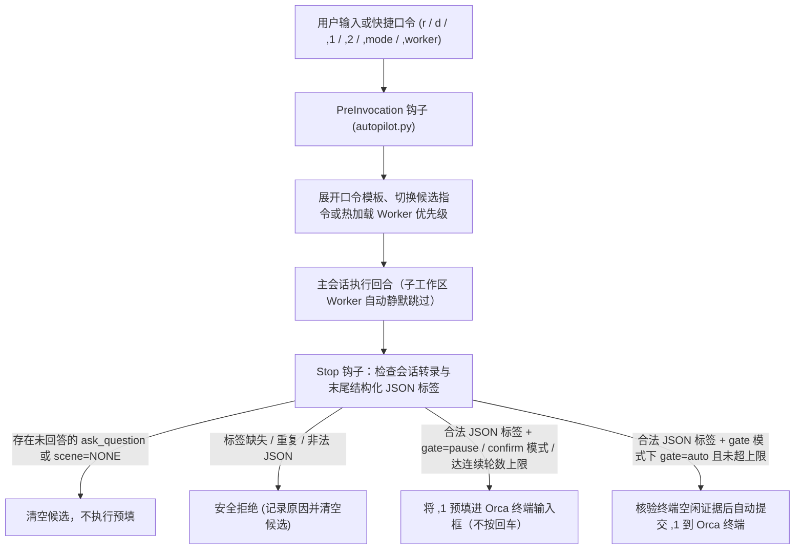

# the-pilot

[](LICENSE)
[](pyproject.toml)
[](pyproject.toml)
[](https://skills.sh/sensebeing/the-pilot)
[](https://github.com/sensebeing/the-pilot/stargazers)

**让你的 AI 编程会话从方案设计一路推进到合入交付。**

面向 AI 研发团队的场景化回合自动驾驶（Turn Autopilot）与 Orca 主从编排治理工具。

多步骤研发任务很难靠一句提示词走完。一个功能或根因修复通常要经过架构设计、子工作区隔离实现、代码审查、主干合入、环境核验和工作区清理。没有回合自动推进时，会话每跑完一轮都会停下来等人输入“继续 review”、“合入 main”或“清理工作区”。简单的自动回车脚本又会在 Agent 还在提问等待确认时盲目回车，或者用脆弱的正则表达式抓取 Markdown 正文，遇到反引号就解析失败。

`the-pilot` 把每次 Agent 回合结束转化为确定性的下一步：主会话负责架构设计与复审，Orca 子会话在独立分支内编码；运行时只通过 `json.loads` 读取回复末尾的结构化 JSON 标签（零正则），在提问已结算、轮数未超限且终端空闲时完成预填或自动提交。

| 没有 `the-pilot` | 接入 `the-pilot` |
| --- | --- |
| 多步骤任务每跑完一轮就停下等人输入“继续 review”、“合入 main”或“清理工作区”；简单的自动回车脚本又会在 Agent 还在提问等待确认时盲目回车，或者用正则抓 Markdown 正文时被反引号截断。 | 主会话负责架构设计与复审，Orca 子工作区在独立分支编码；每轮结束时运行时只通过 `json.loads` 读取末尾 JSON 标签（零正则），在 `gate` 模式下自动推进常规研发阶段，遇到方案取舍时仅预填输入框（`gate=pause`），遇到未回答的 `ask_question` 时自动停下。 |

[English](README.md) · [快速开始](#快速开始) · [预设与四维定制](#三档预设与四维定制矩阵) · [四场景状态机](#四场景状态机) · [工作流](#工作流) · [项目扩展层](#项目扩展层-pilotprojectjson) · [安装技能](skills/the-pilot-setup/SKILL.md) · [日常技能](skills/the-pilot/SKILL.md)

## 30 秒上手：复制给你的 Agent

把下面这段话发给 Antigravity、Claude Code、Codex、Cursor 或 Orca：

```text
请为我的开发环境安装并配置 https://github.com/sensebeing/the-pilot。
安装 CLI（`uv tool install git+https://github.com/sensebeing/the-pilot` 或 `python3 -m pip install git+https://github.com/sensebeing/the-pilot`），
安装技能（`npx skills add sensebeing/the-pilot --global --agent '*'` 或从本地检出目录创建软链），
然后按 skills/the-pilot-setup/SKILL.md 运行 `pilot distill --days 7 --json` 分析我最近 7 天的多 Agent 聊天记录，给出场景与快捷口令建议、确认四维偏好并完成 pilot status 验证。
```

## 为什么做这个工具

在我们团队日常使用 Orca 开发时，一个任务通常由一个主会话（Coordinator）负责架构设计与代码审查，同时拉起一个或多个 Codex、Claude Code 子工作区（Dispatched Worker）在独立分支上编码。

我们希望常规工程阶段能够自动衔接推进，遇到需要人工判断的节点则及时停下。常规确定性阶段（A 类），比如代码改完后触发全任务最简架构复审、复审通过后按策略合入验证、验证完毕后同步台账并回收工作区，在 `gate` 模式下会自动推进。涉及方案取舍与合同边界确认的节点（B 类）则会暂停（`gate=pause`），只把主推指令预填进终端输入框等待确认；如果回合内发起了未结算的提问（`ask_question`），则输出 `scene=NONE` 停止预填。

正文中的 `,1` 和 `,2` 建议行供人阅读（可以包含内联反引号、代码块或符号），运行时只通过 `json.loads` 解析回复末尾的 JSON 注释标签（`<!-- autopilot: {...} -->`）。

## 快速开始

### 1. 安装

需 Python 3.11+，支持 macOS 与 Linux（使用 `fcntl` 文件锁），可直接从 GitHub 安装 `pilot` CLI：

```sh
uv tool install git+https://github.com/sensebeing/the-pilot
# 或使用 pip：
python3 -m pip install git+https://github.com/sensebeing/the-pilot
```

为 Antigravity、Claude Code、Codex、Cursor、Gemini CLI、GitHub Copilot 或 Windsurf 安装技能（`$the-pilot` 与 `$the-pilot-setup`）：

```sh
npx skills add sensebeing/the-pilot --global --agent '*'
```

在 Claude Code 中也可以通过插件市场安装：

```text
/plugin marketplace add sensebeing/the-pilot
/plugin install the-pilot@the-pilot
```

CLI 无外部运行时依赖；终端预填与自动回车依赖 Orca 以及兼容 Antigravity 生命周期 Hook（`PreInvocation` 与 `Stop`）的宿主。

### 2. 初始化

```sh
pilot probe --no-project --json
pilot distill --days 7 --json
pilot apply --no-project --preset recommended --json
pilot status --json
```

`pilot distill --days 7 --json` 会只读扫描最近 7 天本机常用编码 Agent（Antigravity、Claude Code、Codex 与 Cursor）的聊天记录，过滤机器派发噪声，提炼重复出现的手动输入模式并给出场景、质量底线与快捷口令建议。

如果当前仓库带有 `<repo>/.pilot/project.json` 项目扩展配置，可在安装时一并绑定：

```sh
pilot apply --project /path/to/repo --preset recommended --json
```

安装 Python 包本身不会自动修改用户目录；执行 `pilot apply` 时才会写入托管的运行时脚本、场景文件、`GEMINI.md` 托管块与生命周期 Hook 组。

### 3. 在对话中切换模式与执行器

在聊天输入框或终端中均可直接控制：

```sh
# 在聊天框中直接输入（由 PreInvocation 钩子处理）：
,mode gate          # gate=auto 时自动回车推进（受连续轮数上限保护），gate=pause 时仅预填
,mode confirm       # 仅将下一步建议预填进输入框，始终等待人工按 Enter
,mode off           # 关闭回合末自动预填
,worker codex       # 切换 Orca 子会话优先级为 Codex > Claude Code（下一轮自动热加载）
,1                  # 发送主推建议（支持 `,1 补充说明` 自动拼接）
,2                  # 切换并发送备选建议 `,2`
```

## 三档预设与四维定制矩阵

### 内置三档预设

| 预设档位 | Autopilot 模式 | 连续自动轮数上限 | 启用场景 | 默认交付策略 | 默认口令 | 适用场景 |
| --- | --- | --- | --- | --- | --- | --- |
| `recommended` | `gate` | `8` | 全部 4 个场景 | `merge_dev_e2e` | `r`、`rt`、`d`、`pull`（含项目扩展） | 推荐默认：确定性研发阶段自动衔接推进，遇到方案裁决或生产发布暂停确认。 |
| `conservative` | `confirm` | `4` | 全部 4 个场景 | `merge_dev_e2e` | `r`、`rt`、`d`、`pull`（含项目扩展） | 人工确认模式：每轮结束把建议预填到输入框，等待按 Enter 发送。 |
| `orchestration-only` | `off` | `4` | 无（`[]`） | `merge_dev_e2e` | 无（`[]`） | 仅主从编排规范：注入 Orca 主从职责与分支隔离规范，关闭回合末自动预填。 |

### 四维定制能力矩阵（`orca-autopilot-profile/v1`）

| 定制维度 | Profile 配置键 | 可选值与默认值 | 控制内容 |
| --- | --- | --- | --- |
| 1. 主从编排（Orchestration） | `worker_agents`<br>`review_agents` | 子会话：`["codex", "claude"]` 或 `["claude", "codex"]`<br>审查：`["codex", "claude", "agy"]` | 主会话（设计/Review）与子会话（分支编码）职责分离、父子工作区层级、执行器优先级持久化与下一轮热加载。 |
| 2. 自动推进（Autopilot） | `mode`<br>`max_consecutive_auto_turns` | 模式：`gate` \| `confirm` \| `off`<br>轮数上限：`1..50`（默认 `8`） | 控制 `gate=auto` 是否自动回车，以及达到连续自动推进上限后回退为仅预填。 |
| 3. 场景状态机（Scenes） | `enabled_scenes`<br>`deliver_strategy`<br>`enable_feedback_email`<br>`guardrails` | 交付策略：`merge_dev_e2e` \| `merge_dev_only` \| `local_verify_only`<br>反馈发信：`false` \| `true` | 控制启用哪些场景、交付阶段生成哪些验证指令，以及按场景注入自定义质量底线要求。 |
| 4. 快捷口令（Shortcuts） | `enabled_entry`<br>`custom_entry`<br>`custom_comma`<br>`template_overrides` | 通用口令：`r`、`rt`、`d`、`pull`<br>外加项目扩展口令与自定义 `,` 别名 | 在 `PreInvocation` 阶段将简短口令（例如 `r auth`）展开为完整的架构审查或编排提示词。 |

## 四场景状态机

主会话在每个回合结束时，先按任务性质判定是否需要向用户提问或停下确认方案（A 类确定性收敛 vs. B 类方案裁决），再路由到下方 4 个正交场景（或 `NONE`），在正文中打印可见的 `,1` / `,2` 建议，并在回复末尾输出唯一的结构化 JSON 标签：

```html
<!-- autopilot: {"scene": "plan-and-orchestrate", "gate": "auto", "1": "主推指令文本", "2": "备选指令文本"} -->
```

| 场景标识 | 触发时机 | 默认门禁 | 下一步核心职责 |
| --- | --- | --- | --- |
| `plan-and-orchestrate` | 刚完成初版架构审查报告、新需求设计方案、问题根因定位（需改代码）或复审待改清单。 | `auto`（A 类）<br>`pause`（B 类） | 从架构源头收敛方案，明确唯一 Owner 与模块契约，通过 Orca 编排子工作区推进实施并严格 Review。 |
| `architecture-re-review` | 本会话整个任务涉及的代码在本轮发生了实施或整改（哪怕已合入 `main`）。 | `auto` | 对照最初的设计和审查文档，对本会话整个任务涉及的代码做最简架构复审，清理表象补丁与工程质量问题。 |
| `deliver-and-verify` | 按实际代码行为核查后，最简架构与工程质量问题已清零，尚有未完成的合入或环境核验步骤。 | `auto`（进 prod 前强制 `pause`） | 按配置的交付策略（`merge_dev_e2e`、`merge_dev_only` 或 `local_verify_only`）完成剩余交付与验证步骤。 |
| `closeout-and-sync` | 代码复审与交付验证均已完成，尚有文档、台账同步、告警/反馈结案或 Orca 工作区回收未完成。 | `auto` | 同步设计文档与 `WORKING.md`、释放 Orca 受控子会话（`worker-release`）、回收工作区并将收尾改动落回 `origin/main`。 |
| `NONE` | 正在等待用户回答 `ask_question`，或代码、交付、文档与工作区收尾已全部结清。 | 不预填 | 输出 `<!-- autopilot: {"scene": "NONE"} -->`，清空候选并结束。 |

默认交付策略为 `merge_dev_e2e`：部署后执行受影响链路的定向 dev E2E；无需验证或缺少执行条件时说明具体原因与剩余风险后收尾。prod 与全量/批量套件仍需当轮明确授权。`merge_dev_only` 可显式选择仅部署核验。

## 工作流



1. 运行时通过识别 JSON 字符串引号状态的扫描器定位末尾 `<!-- autopilot: ... -->` 注释，并仅通过 `json.loads` 解析标签字段。候选文本中的反引号、`**`、`<!--...-->`、`-->`、换行与冒号均原样保留。
2. 每次 `Stop` 事件触发时，`autopilot.py` 会读取会话转录（遇到截断字段自动从 `transcript_full.jsonl` 补齐），确认所有同步或异步提问工具（`ask_question`、`AskUserQuestion`、`request_user_input`）在同一回合内均已拿到回答，否则不执行预填或自动回车。
3. 向 Orca 终端发送按键前，运行时在 `fcntl` 独占锁下写入 `pending` 投递预留状态。若 `orca terminal send` 超时或返回状态不明，会话将冻结后续自动投递，直到用户手动输入或显式执行 `,autopilot recover`，避免重复发送。

## 与现有工具如何配合

| 工具 | 核心职责 | `the-pilot` 如何配合 |
| --- | --- | --- |
| Orca (`orca` CLI) | 工作区生命周期、终端复用与主从受控编排（Coordinator / Worker）。 | 规范主从工作区创建与释放纪律，校验终端空闲证据，并将预填和自动回车投递到当前会话终端。 |
| [the-guard](https://github.com/sensebeing/the-guard) | 仓库级工程质量规范、静态拓扑棘轮与独立 Agent 合入前架构审查。 | 驱动 `architecture-re-review` 场景循环，在每次代码改动后先完成全局最简架构复审再进入交付。 |
| [the-dealer](https://github.com/sensebeing/the-dealer) | 同机多 Agent 与跨机、跨团队加密 P2P 协作派发。 | 支持通过项目 `.pilot/project.json` 挂载团队协作波次口令（如 `dl`、`dls`、`dla`），保持传输层职责独立。 |

## 项目扩展层（`.pilot/project.json`）

通用模式保持项目无关（默认启用 `r`、`rt`、`d`、`pull`）。项目可在仓库根目录放置 `.pilot/project.json`（`schema: "the-pilot-project/v1"`，参考 [examples/project.example.json](examples/project.example.json)），按需叠加项目专属口令、预设、交付说明与收尾动作：

```json
{
  "schema": "the-pilot-project/v1",
  "projectId": "example",
  "description": "A project-specific closeout instruction.",
  "scene_specs": {
    "closeout-and-sync": {
      "fallback_prompt": "Update project documentation and release owned resources."
    }
  }
}
```

```sh
pilot apply --project /path/to/repo --preset recommended --json
pilot apply --upgrade --json       # 升级运行时与产物，保留已安装的项目扩展与个人偏好
pilot apply --no-project --json    # 解除项目扩展绑定，恢复通用默认规格
```

项目配置发现按以下顺序查找：显式 `--no-project`、显式 `--project <仓库或JSON路径>`、已安装的 `project.json` 副本、当前目录向上最近的 `.pilot/project.json`，最后回退到通用默认规格。未知字段直接报错拒绝，新增入口口令必须声明在 `entry_order` 中且命令标识唯一，内置场景文件名固定在托管目录内。

## 命令参考

| 命令 | 用途 |
| --- | --- |
| `pilot probe [--project <repo> \| --no-project] --json` | 只读探测已安装的个人偏好、项目扩展与本机可用的 Agent CLI（`codex`、`claude`、`agy`）。 |
| `pilot distill [--days 7] [--max-sessions 80] --json` | 只读扫描最近 N 天多 Agent 聊天记录（`antigravity`、`claude`、`codex`、`cursor`），提炼重复输入模式与场景、口令自动化建议。 |
| `pilot apply [--preset <name>] [--project <repo>] [--profile <json>] [--upgrade] --json` | 编译并原子安装 `autopilot.py`、`config.json`、`scenes/*.md`、`GEMINI.md` 托管块与 Hook 组。 |
| `pilot status [--project <repo>] --json` | 检查安装完整性、当前模式、执行器优先级与字节级产物漂移（`drift: []`）。 |
| `pilot uninstall --json` | 移除托管文件、`GEMINI.md` 托管块与 Hook 条目，保留用户其他配置。 |
| `pilot mode [status\|gate\|confirm\|off]` | 查看或切换 Turn Autopilot 模式（`gate`、`confirm`、`off`）。 |
| `pilot worker [status\|codex\|claude\|cc]` | 查看或持久化子会话执行器优先级（`codex > claude` 或 `claude > codex`），并在下一轮热加载。 |
| `pilot sync` | 手工编辑已安装的 `scenes/*.md` 后，将其同步刷新到 `GEMINI.md` 场景段。 |
| `pilot set <shortcut> <template>` | 在 `profile.json` 中持久化自定义口令模板并重新编译 `config.json`。 |
| `pilot log [--lines <n>]` | 查看 `state/autopilot.log` 中的结构化运行时投递日志。 |
| `pilot hook --event <PreInvocation\|Stop>` | 供宿主 Agent 运行时调用的生命周期 Hook 入口。 |

安装器命令支持 `--gemini-dir <路径>`；运行时命令支持通过 `ORCA_AUTOPILOT_GEMINI_DIR` 指定配置根目录。

## 开发与自举检验

`the-pilot` 已接入 [the-guard](https://github.com/sensebeing/the-guard)，执行单向模块依赖拓扑（`cli -> installer -> compiler -> profile -> project -> defaults`）、独立单文件运行时（`assets/autopilot.py`）与全仓禁用 `re` 正则导入检查：

```sh
PYTHONPATH=src python3 -m unittest discover -s tests -v
guard topology sync --repo-root .
guard check --repo-root . --base origin/main
guard review --repo-root .
```

内部包结构与模块职责边界见 [src/the_pilot/README.md](src/the_pilot/README.md)，环境搭建与审查要求见[贡献指南](CONTRIBUTING.md)，私密漏洞报告见[安全政策](SECURITY.md)，版本历史见[变更日志](CHANGELOG.md)。

## 相关开源项目

`the-pilot` 是 SenseBeing 面向 AI 原生研发团队开源工具集的组成部分：

| 项目 | 作用 |
| --- | --- |
| [the-guard](https://github.com/sensebeing/the-guard) | 仓库级工程质量护栏、确定性拓扑棘轮与独立 Agent 合入前架构审查。 |
| [the-dealer](https://github.com/sensebeing/the-dealer) | 同机多 Agent 派发与跨机、跨团队加密 P2P 任务协同节点。 |

如果 `the-pilot` 对你们团队用 AI 写代码有帮助，欢迎在 GitHub 点一颗 Star，让更多团队看到它。

## 许可证

[MIT](LICENSE)
