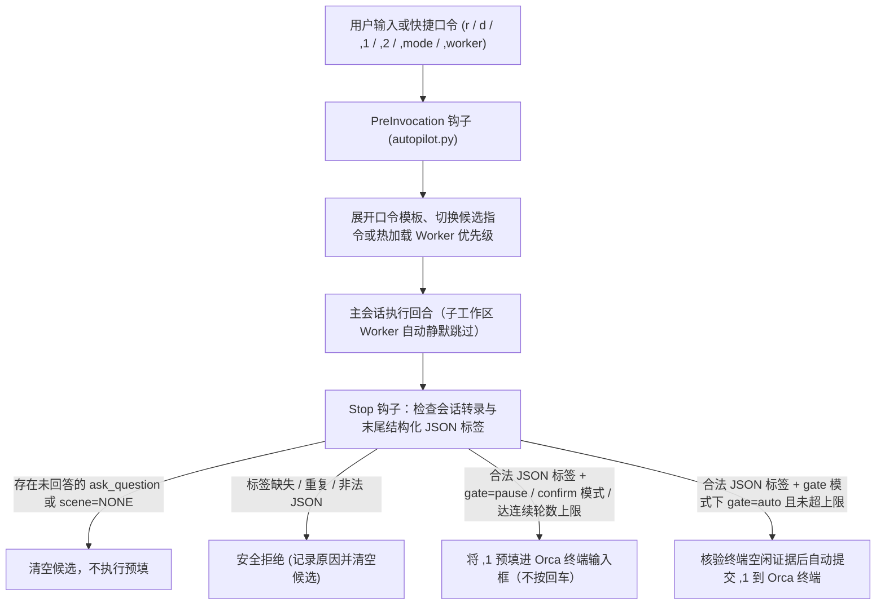

# the-pilot

[](LICENSE)
[](pyproject.toml)
[](pyproject.toml)

**让你的 AI 编程会话自动往下推进——既不断档，也不越界。**

面向 AI 研发团队的场景化回合自动驾驶（Turn Autopilot）与 Orca 主从编排治理工具。

真实的复杂研发任务几乎不可能靠一句提示词走完。从方案收敛、派发子工作区编码、不留情面的架构复审，到合入主干、环境核验与工作区回收，中间往往横跨十几个回合。没有自动推进时，人必须守在终端前一遍遍敲“继续 review”、“合入 main”、“清理工作区”；而简陋的自动回车脚本又会走向另一个极端——在 Agent 还在提问等待确认时盲目回车，或者靠脆弱的正则表达式抓取 Markdown 正文，遇到一个反引号就彻底罢工。

`the-pilot` 让每一次 Agent 回合结束都转化为确定、可控的下一步行动：主会话专注架构设计与复审，Orca 子会话在隔离分支内编码；运行时完全摒弃正则表达式，只用 `json.loads` 读取回复末尾唯一的结构化 JSON 标签，并在提问已结算、轮数未超限、终端空闲证据确凿时机械完成预填或自动提交。

[English](README.md) · [快速开始](#快速开始) · [预设与四维定制](#三档预设与四维定制矩阵) · [四场景状态机](#四场景状态机) · [工作流](#工作流) · [项目扩展层](#项目扩展层-pilotprojectjson) · [安装技能](skills/the-pilot-setup/SKILL.md) · [日常技能](skills/the-pilot/SKILL.md)

## 30 秒上手：复制给你的 Agent

把下面这段话粘贴给 Antigravity、Claude Code、Codex 或 Orca：

```text
请在保留我现有配置与钩子的前提下安装并配置 the-pilot。

1. 检查 `python3 --version`（要求 Python >= 3.11）和 `command -v pilot`。
   如果尚未安装 `pilot`，将 https://github.com/sensebeing/the-pilot.git 克隆到 ~/the-pilot
   （已有检出则用 `git -C ~/the-pilot pull --ff-only` 更新），然后运行
   `python3 -m pip install -e ~/the-pilot` 安装（也可以直接使用 `~/the-pilot/bin/pilot`）。
2. 将 `~/the-pilot/skills/the-pilot` 和 `~/the-pilot/skills/the-pilot-setup`
   以符号链接注册到已存在的 `~/.agents/skills/`、`~/.claude/skills/`、
   `~/.gemini/config/skills/` 目录，保留已有文件。
   阅读 `~/the-pilot/skills/the-pilot-setup/SKILL.md`。
3. 运行 `pilot probe --json`（若当前仓库含 `.pilot/project.json` 则带上 `--project <当前仓库>`），
   只读探测我现有的配置偏好与本机可用的 Agent CLI（`codex`、`claude`、`agy`）。
4. 按四个定制维度向我确认偏好（将推荐项置首）：
   - 编排子 Agent 与独立审查优先级（`codex > claude` 或 `claude > codex`）
   - Turn Autopilot 模式（`gate`、`confirm` 或 `off`）与连续自动推进上限轮数
   - 启用的场景、交付策略（`merge_dev_only`、`merge_dev_e2e`、`local_verify_only`）与自定义质量底线
   - 启用的入口口令（`r`、`rt`、`d`、`pull` 及项目专属口令）与自定义 `,` 别名
5. 用 `pilot apply` 应用我确认的偏好，运行 `pilot status --json` 确认 `drift: []`，
   最后给我一份个性化的日常操作速查表。
```

如果 `pilot` 已安装在其他位置，请先定位源码检出目录（或克隆到 `~/the-pilot`），供第 2 步注册技能。使用直接启动器时，将后续命令中的 `pilot` 替换为 `~/the-pilot/bin/pilot`。

## 为什么做这个工具

在我们日常使用 Orca 开发时，一个常规需求往往由一个主会话（Coordinator）负责工程架构级方案设计与严格 Code Review，同时拉起一个或多个 Codex / Claude Code 子工作区（Dispatched Worker）在独立分支上实施。

我们希望这套研发流水线在确定性的工程阶段之间能够自动咬合推进，同时**绝不突破安全边界**：
- **确定性收敛阶段（A 类）**——例如代码改完后自动触发全任务最简架构复审、复审零问题后按既定策略合入验证、验证完毕后同步台账并回收工作区——在 `gate` 模式下应当无需人工干预自动推进。
- **方案与设计裁决（B 类）**——例如 0→1 新机制取舍、跨模块合同变更或生产发布门禁——必须自动暂停（`gate=pause`），将主推指令预填进终端输入框等待人工确认；一旦回合内发起了未结算的提问（`ask_question`），则强制输出 `scene=NONE` 停止预填。
- **展示层与执行层彻底解耦**：正文中的 `,1` / `,2` 建议行仅供人类阅读（可自由包含内联反引号、Markdown 加粗或代码块）；运行时完全禁用正则表达式，只通过 `json.loads` 解析回复末尾唯一的结构化 JSON 注释标签（`<!-- autopilot: {...} -->`）。

## 快速开始

### 1. 安装

需 Python 3.11+，支持 macOS 与 Linux（使用 `fcntl` 文件锁）：

```sh
python3 -m pip install /path/to/the-pilot
```

也可以直接运行检出目录下的 `/path/to/the-pilot/bin/pilot`。CLI **零外部运行时依赖**；真实终端预填与自动回车依赖 Orca 以及兼容 Antigravity 生命周期 Hook（`PreInvocation` 与 `Stop`）的宿主。

### 2. 30 秒极速启用

```sh
pilot probe --no-project --json
pilot apply --no-project --preset recommended --json
pilot status --json
```

如果当前仓库定义了项目扩展配置 `<repo>/.pilot/project.json`，可在安装时一并绑定：

```sh
pilot apply --project /path/to/repo --preset recommended --json
```

安装 Python 包本身不会自动修改任何用户目录；只有显式执行 `pilot apply` 时，编译器才会原子写入托管的运行时脚本、四场景文件、`GEMINI.md` 托管块与生命周期 Hook 组。

### 3. 在对话中随时切换模式与执行器

在聊天输入框或终端中均可直接控制：

```sh
# 在聊天框中直接输入（由 PreInvocation 钩子拦截处理）：
,mode gate          # gate=auto 时自动回车推进（受连续轮数上限保护），gate=pause 时仅预填
,mode confirm       # 仅将下一步建议预填进输入框，始终等待人工按 Enter
,mode off           # 关闭回合末自动预填
,worker codex       # 切换 Orca 子会话优先级为 Codex > Claude Code（下一轮自动热加载）
,1                  # 发送主推建议（支持 `,1 补充说明` 自动拼接）
,2                  # 切换并发送备选建议 `,2`
```

## 三档预设与四维定制矩阵

### 内置三档预设

| 预设档位 | Autopilot 模式 | 连续自动轮数上限 | 启用场景 | 默认交付策略 | 默认口令 | 适用场景 |
| --- | --- | --- | --- | --- | --- | --- |
| `recommended` | `gate` | `8` | 全部 4 个场景 | `merge_dev_only` | `r`、`rt`、`d`、`pull`（含项目扩展） | **推荐默认** — 确定性研发阶段自动衔接推进，遇到方案裁决或生产发布自动暂停确认。 |
| `conservative` | `confirm` | `4` | 全部 4 个场景 | `merge_dev_only` | `r`、`rt`、`d`、`pull`（含项目扩展） | **人工确认模式** — 每轮结束自动把建议预填到输入框，始终由你按 Enter 才发送。 |
| `orchestration-only` | `off` | `4` | 无（`[]`） | `merge_dev_only` | 无（`[]`） | **仅主从编排规范** — 只注入 Orca 主从职责与分支隔离规范，关闭回合末自动预填。 |

### 四维定制能力矩阵（`orca-autopilot-profile/v1`）

| 定制维度 | Profile 配置键 | 可选值与默认值 | 控制内容 |
| --- | --- | --- | --- |
| **1. 主从编排（Orchestration）** | `worker_priority`<br>`review_priority` | 子会话：`["codex", "claude"]` 或 `["claude", "codex"]`<br>审查：`["codex", "claude", "agy"]` | 主会话（设计/Review）与子会话（分支编码）职责分离、父子工作区层级、执行器优先级持久化与下一轮热加载。 |
| **2. 自动推进（Autopilot）** | `mode`<br>`max_consecutive_auto_turns` | 模式：`gate` \| `confirm` \| `off`<br>轮数上限：`1..20`（默认 `8`） | 控制 `gate=auto` 是否自动回车，以及达到连续自动推进上限后自动退化为仅预填。 |
| **3. 场景状态机（Scenes）** | `enabled_scenes`<br>`deliver_strategy`<br>`enable_feedback_email`<br>`custom_guardrails` | 交付策略：`merge_dev_only` \| `merge_dev_e2e` \| `local_verify_only`<br>反馈发信：`false` \| `true` | 控制启用哪些场景、交付阶段如何生成验证指令，以及按场景注入自定义架构底线要求。 |
| **4. 快捷口令（Shortcuts）** | `enabled_entry`<br>`custom_entry`<br>`custom_comma`<br>`template_overrides` | 通用口令：`r`、`rt`、`d`、`pull`<br>外加项目扩展口令与自定义 `,` 别名 | 在 `PreInvocation` 阶段将简短口令（如 `r auth`）确定性展开为完整的架构审查或编排提示词。 |

## 四场景状态机

主会话在每个回合结束时，先按任务性质判定是否需要向用户提问或停下确认方案（A 类确定性收敛 vs. B 类方案裁决），再路由到下方 4 个正交场景（或 `NONE`），在正文中打印可见的 `,1` / `,2` 建议，并在回复末尾输出唯一的结构化 JSON 标签：

```html
<!-- autopilot: {"scene": "plan-and-orchestrate", "gate": "auto", "1": "主推指令文本", "2": "备选指令文本"} -->
```

| 场景标识 | 触发时机 | 默认门禁 | 下一步核心职责 |
| --- | --- | --- | --- |
| `plan-and-orchestrate` | 刚完成初版架构审查报告、新需求设计方案、问题根因定位（需改代码）或复审待改清单。 | `auto`（A 类）<br>`pause`（B 类） | 从架构源头收敛方案，明确唯一 Owner 与模块契约，通过 Orca 编排子工作区推进实施并严格 Review。 |
| `architecture-re-review` | 本会话整个任务涉及的代码在本轮发生了实施或整改（哪怕已合入 `main`）。 | `auto` | 对照最初的设计/审查文档，对本会话整个任务涉及的代码做最简架构复审，清零表象补丁与工程质量问题。 |
| `deliver-and-verify` | 按实际代码行为核查后，最简架构与工程质量问题已清零，尚有未完成的合入或环境核验步骤。 | `auto`（进 prod 前强制 `pause`） | 按配置的交付策略（`merge_dev_only`、`merge_dev_e2e` 或 `local_verify_only`）完成未执行的交付与验证闭环。 |
| `closeout-and-sync` | 代码复审与交付验证均已完成，尚有文档/台账同步、告警/反馈结案或 Orca 工作区回收未完成。 | `auto` | 同步设计文档与 `WORKING.md`、释放 Orca 受控子会话（`worker-release`）、回收工作区并将收尾改动落回 `origin/main`。 |
| `NONE` | 正在等待用户回答 `ask_question`，或代码、交付、文档与工作区收尾已全部结清。 | 不预填 | 输出 `<!-- autopilot: {"scene": "NONE"} -->`，清空候选并安静结束。 |

## 工作流



1. **唯一结构化真源，零正则表达式**：运行时通过识别 JSON 字符串引号状态的扫描器定位末尾 `<!-- autopilot: ... -->` 注释，并仅通过 `json.loads` 解析标签字段。候选文本中的反引号、`**`、`<!--...-->`、`-->`、换行与冒号均原样保留，绝不因 Markdown 修饰符差异导致预填失败。
2. **提问未答硬拦截**：每次 `Stop` 事件触发时，`autopilot.py` 会读取会话转录（遇到截断字段自动从 `transcript_full.jsonl` 补齐），确认所有同步或异步提问工具（`ask_question`、`AskUserQuestion`、`request_user_input`）在同一回合内均已拿到真实回答，否则一律禁止预填与自动回车。
3. **不确定投递安全锁**：向 Orca 终端发送按键前，运行时在 `fcntl` 独占锁下写入 `pending` 投递预留状态。若 `orca terminal send` 超时或返回状态不明，会话将自动冻结后续自动投递，直到用户手动输入或显式执行 `,autopilot recover`，绝不盲目重发。

## 与现有工具如何配合

`the-pilot` 与多 Agent 编排和工程质量护栏协同工作：

| 工具 | 核心职责 | `the-pilot` 如何与之配合 |
| --- | --- | --- |
| **Orca** (`orca` CLI) | 工作区生命周期、终端复用与主从受控编排（Coordinator / Worker）。 | 规范主从工作区创建与释放纪律，校验终端空闲证据，并将预填/自动回车精准投递到当前会话终端。 |
| **[the-guard](https://github.com/sensebeing/the-guard)** | 仓库级工程质量规范、静态拓扑棘轮与独立 Agent 合入前架构审查。 | 驱动 `architecture-re-review` 场景循环，确保每次实施后都经过全局最简架构审视再进入交付。 |
| **The Dealer** (`dealer` CLI) | 同机多 Agent 与跨机/跨团队加密 P2P 协作派发。 | 支持通过项目 `.pilot/project.json` 挂载团队协作波次口令（如 `dl`、`dls`、`dla`），同时保持双方职责边界正交。 |

## 项目扩展层（`.pilot/project.json`）

通用模式保持项目无关（默认仅启用 `r`、`rt`、`d`、`pull`）。项目可在仓库根目录放置 `.pilot/project.json`（`schema: "the-pilot-project/v1"`，参考 [examples/project.example.json](examples/project.example.json)），按需叠加项目专属口令、预设、交付说明与收尾动作：

```json
{
  "schema": "the-pilot-project/v1",
  "projectId": "example",
  "description": "A project-specific closeout instruction.",
  "scene_specs": {
    "closeout-and-sync": {
      "fallback_prompt": "Update project documentation and release owned resources."
    }
  }
}
```

```sh
pilot apply --project /path/to/repo --preset recommended --json
pilot apply --upgrade --json       # 升级运行时与产物，自动保留已安装的项目扩展与个人偏好
pilot apply --no-project --json    # 解除项目扩展绑定，恢复通用默认规格
```

- **项目配置发现顺序**：显式 `--no-project` → 显式 `--project <仓库或JSON路径>` → 已安装的 `project.json` 副本 → 当前目录向上最近的 `.pilot/project.json` → 通用默认规格。
- **严格 Schema 校验**：未知字段直接报错拒绝，新增入口口令必须声明在 `entry_order` 中且命令标识唯一，内置场景文件名固定在托管目录内。

## 命令参考

| 命令 | 用途 |
| --- | --- |
| `pilot probe [--project <repo> \| --no-project] --json` | 只读探测已安装的个人偏好、项目扩展与本机可用的 Agent CLI（`codex`、`claude`、`agy`）。 |
| `pilot apply [--preset <name>] [--project <repo>] [--profile <json>] [--upgrade] --json` | 纯函数编译并原子安装 `autopilot.py`、`config.json`、`scenes/*.md`、`GEMINI.md` 托管块与 Hook 组。 |
| `pilot status [--project <repo>] --json` | 检查安装完整性、当前模式、执行器优先级与字节级产物漂移（`drift: []`）。 |
| `pilot uninstall --json` | 干净移除托管文件、`GEMINI.md` 托管块与 Hook 条目，完整保留用户其他配置。 |
| `pilot mode [status\|gate\|confirm\|off]` | 查看或切换 Turn Autopilot 模式（`gate`、`confirm`、`off`）。 |
| `pilot worker [status\|codex\|claude\|cc]` | 查看或持久化子会话执行器优先级（`codex > claude` 或 `claude > codex`），并在下一轮热加载。 |
| `pilot sync` | 手工编辑已安装的 `scenes/*.md` 后，将其同步刷新到 `GEMINI.md` 场景段。 |
| `pilot set <shortcut> <template>` | 在 `profile.json` 中持久化自定义口令模板并重新编译 `config.json`。 |
| `pilot log [--lines <n>]` | 查看 `state/autopilot.log` 中的结构化运行时投递日志。 |
| `pilot hook --event <PreInvocation\|Stop>` | 供宿主 Agent 运行时调用的生命周期 Hook 入口。 |

安装器命令支持 `--gemini-dir <路径>`；运行时命令支持通过 `ORCA_AUTOPILOT_GEMINI_DIR` 指定配置根目录。

## 开发与自举检验

`the-pilot` 自身已接入 [the-guard](https://github.com/sensebeing/the-guard)，强制执行单向模块依赖拓扑（`cli -> installer -> compiler -> profile -> project -> defaults`，独立单文件运行时 `assets/autopilot.py`，且全仓源码禁用 `re` 正则导入）：

```sh
PYTHONPATH=src python3 -m unittest discover -s tests -v
guard check --repo-root . --base origin/main
guard review --repo-root .
```

内部包架构与模块边界详见 [src/the_pilot/README.md](src/the_pilot/README.md)。

开发环境搭建与审查要求见[贡献指南](CONTRIBUTING.md)，私密漏洞报告见[安全政策](SECURITY.md)，版本历史见[变更日志](CHANGELOG.md)。

## 许可证

[MIT](LICENSE)
