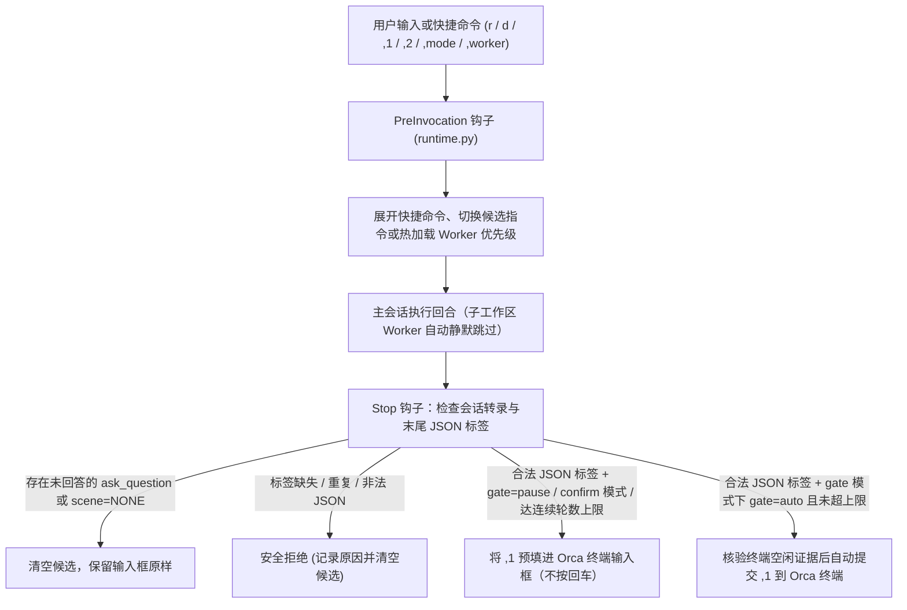

# the-pilot

[](LICENSE)
[](pyproject.toml)
[](pyproject.toml)
[](https://skills.sh/sensebeing/the-pilot)
[](https://github.com/sensebeing/the-pilot/stargazers)

**Coding Agent 回合自动驾驶（Turn Pilot）：自动生成填入输入框的建议、流程性步骤自动回车推进、遇到产品与工程判断停下来等确认、支持快捷命令一键展开。**

平时用 Coding Agent 写代码，大多数回合结束时人都在做同一件事：读一遍总结，然后手动把下一句衔接指令打进输入框（“review 一下这个分支”、“合入 main 并发 dev”、“跑一下 E2E”、“清理工作区并更新文档”）。`the-pilot` 在终端里接管这些流程性操作，让你把精力放在产品和工程架构判断上。

[English](README.md) · [它能做什么](#它能做什么4-个日常场景) · [实现原理](#实现原理通过判断场景驱动流水线) · [快速开始](#快速开始) · [预设与四维定制](#三档预设与四维定制矩阵) · [项目扩展层](#项目扩展层-pilotprojectjson) · [命令参考](#命令参考)

---

## 它能做什么（4 个日常场景）

接入 `the-pilot` 后，你的 Agent 终端直接具备以下 4 项能力：

### 1. 自动生成并填入输入框的下一步建议

每个回合结束时，Agent 会在回复末尾给出主推（`,1`）与备选（`,2`）下一步指令，`the-pilot` 会自动把 `,1` 预填进你的终端输入框：

```text
下一步建议：
- ,1（主推）：合入 main 并发 dev，然后执行相关链路的定向 E2E 测试
- ,2（备选）：先合入 main 并发 dev 完成部署核验，暂不执行 E2E

> 合入 main 并发 dev，然后执行相关链路的定向 E2E 测试█
```

- 直接按 **`Enter`**：立即发送已填入的主推指令。
- 输入 **`,2`**：切换并发送备选指令。
- 输入 **`,1 顺便检查一下迁移 790`**：在主推指令后追加你的补充要求一并发送。

### 2. 流程性的步骤自动回车推进

在默认的 `gate` 模式下，确定性的工程流程衔接不需要你手动按回车。只要当前回合没有未回答的提问且终端已空闲，`the-pilot` 会自动提交 `,1` 推进到下一步：

- **子工作区刚写完代码** → 自动回车触发全任务最简架构与代码复审。
- **代码复审零问题通过** → 自动回车执行合入 `main`、发布 `dev` 与定向验证。
- **交付验证通过** → 自动回车同步文档、释放 Orca 子会话并回收工作区。

内置连续自动推进轮数上限（默认 `8` 轮），超过上限后自动回退为仅预填、不按回车。

### 3. 产品和工程判断停下来等确认

只要涉及需要人拍板的产品取舍或架构边界，`the-pilot` 绝不会盲目按回车：

- **方案与架构取舍（`gate=pause`）**：当回合产出的是 0→1 新功能方案、跨模块接口变更或需要你在多个方案间做选择时，`the-pilot` 只把推荐指令预填进输入框，**停下来等待你确认或修改**。
- **生产环境发布门禁（`gate=pause`）**：进入 `/ship` 发布生产环境前，强制暂停等待人工确认。
- **正在提问澄清或任务已结案（`scene=NONE`）**：当 Agent 调用 `ask_question` 向你提问、或者全部代码与收尾工作已经完成时，`the-pilot` 不做任何预填，把输入框完全留给你。

### 4. 快捷命令一键展开

在聊天输入框里直接输入简短口令，`PreInvocation` 钩子会在发送前自动展开为完整的工程提示词或执行运行时切换：

| 快捷命令 | 作用 |
| --- | --- |
| `r [范围]` | 展开为针对 `[范围]` 的完整架构与工程质量审查提示词。 |
| `rt [范围]` | 对 `[范围]` 完成架构审查后，直接编排子工作区修复发现的问题。 |
| `d [需求]` | 先做根因与最简架构方案设计，再派发隔离的 Orca 子工作区实施并严格复审。 |
| `pull` | 安全快进同步本地 `main` 分支，不破坏脏工作区。 |
| `,mode gate\|confirm\|off` | 随时切换自动回车模式（`gate`）、仅预填确认模式（`confirm`）或关闭（`off`）。 |
| `,worker codex\|claude` | 切换 Orca 子工作区执行器优先级（`Codex > Claude Code` 或 `Claude Code > Codex`），下一轮自动生效。 |

---

## 实现原理：通过判断场景驱动流水线

简单的“自动继续”脚本之所以不可用，是因为它们要么不管三七二十一盲目按回车，要么用正则表达式去抓 Markdown 正文（遇到一个反引号或代码块就解析错乱）。`the-pilot` 的原理是：**由 Agent 在回合末根据上下文判断当前所处场景与门禁类型，再由运行时通过确定性 Hook 执行校验与终端投递。**

### 第一步：提炼最近 7 天的真实对话习惯（`pilot distill`）

初始化时，`pilot distill --days 7 --json` 会只读扫描你本机最近 7 天的多 Agent 聊天记录（支持 Antigravity、Claude Code、Codex、Cursor），过滤机器派发噪声，找出你每天反复手动输入的衔接指令和流程断点，据此生成适合你的场景配置与快捷口令建议。

### 第二步：回合末三步场景判断模型

主会话（Coordinator）在每个回合结束时（被派发的子工作区 Worker 自动保持静默），按三步判断下一步动作：

1. **判断任务性质（决定停不停下来等确认）**：
   - **A 类 — 确定性流程收敛（`gate=auto`）**：正确行为和模块边界已经明确（例如：子工作区刚改完代码需要整体复审、复审通过后合入分支并跑验证、验证通过后清理工作区）。
   - **B 类 — 产品与架构裁决（`gate=pause`）**：0→1 新功能设计、跨模块契约或状态机边界变更、生产环境发布确认。
   - **等待回答或全部完成（`scene=NONE`）**：当前回合有未回答的 `ask_question`，或代码、验证、文档与工作区回收已全部结清。
2. **路由到 4 个标准研发场景（每个场景绑定明确的交付标准与交付质量）**：

| 场景标识 | 触发时机 | 默认门禁 | 本阶段交付物 | 退出质量门槛 |
| --- | --- | --- | --- | --- |
| `plan-and-orchestrate` | 完成初版架构审查报告、新需求方案设计、问题根因定位（需改代码）或复审待改清单。 | `auto`（A 类）<br>`pause`（B 类） | 明确唯一 owner、模块边界、接口契约与子工作区任务的整体方案。 | 覆盖真实根因、调用拓扑与验证路径，不打表象补丁。 |
| `architecture-re-review` | 本任务涉及的代码在本轮发生了任何实施或修改（哪怕已合入 `main`）。 | `auto` | 对本任务全部改动代码的整体架构复审结果与待改问题清单。 | 唯一 owner、职责边界、接口契约与未覆盖风险全部闭合。 |
| `deliver-and-verify` | 最简架构与工程质量问题已清零，尚有分支合入、发 `dev` 或定向 E2E 验证未完成。 | `auto`（进 prod 前强制 `pause`） | 按授权完成分支合入、环境部署及对应链路的实跑验证证据。 | 每个交付动作都有匹配的验证结果与剩余风险说明。 |
| `closeout-and-sync` | 代码复审与交付验证均已完成，尚有文档同步、告警/反馈结案或工作区回收未完成。 | `auto` | 同步设计文档与台账、结清告警/反馈、释放 Orca 子会话并回收工作区。 | `origin/main` 干净同步，无遗留可回收终端或孤儿工作区。 |
| `NONE` | 正在等待用户回答 `ask_question`，或全部代码、交付与收尾义务已结清。 | 不预填 | 无剩余动作。 | 全部义务已结清。 |

3. **输出人类可读建议与唯一末尾 JSON 标签（零正则解析）**：
   - 正文中打印 `,1` / `,2` 建议供人阅读（可自由包含反引号、代码块或任意符号）。
   - 回复末尾输出唯一一行 HTML 注释标签，运行时仅用 `json.loads` 解析该标签：

```html
<!-- pilot: {"scene": "deliver-and-verify", "gate": "auto", "1": "合入 main 并发 dev，然后执行定向 E2E 测试", "2": "先合入 main 并发 dev 完成部署核验"} -->
```

### 第三步：生命周期 Hook 确定性校验与投递（`runtime.py`）



1. **未答提问转录核验**：每次 `Stop` 事件触发时，`runtime.py` 会读取会话转录（截断行自动从 `transcript_full.jsonl` 补齐），确认当前回合所有 `ask_question`、`AskUserQuestion`、`request_user_input` 均已拿到用户回答，否则绝不执行预填或自动回车。
2. **零正则 JSON 标签扫描**：使用识别字符串引号状态的扫描器提取末尾 `<!-- pilot: ... -->` 并调用 `json.loads`。标签缺失、重复或格式非法时一律按暂停处理。
3. **文件锁幂等投递**：向 Orca 终端发送按键前，先在 `fcntl` 排他锁下记录 `pending` 投递预留状态。若 `orca terminal send` 超时或状态不明，自动冻结后续自动回车（直到用户手动输入或执行 `,pilot recover`），防止重复发送。

---

## 快速开始

### 30 秒上手：复制给你的 Agent

把下面这段话直接发给 Antigravity、Claude Code、Codex、Cursor 或 Orca：

```text
请为我的开发环境安装并配置 https://github.com/sensebeing/the-pilot。
安装 CLI（`uv tool install git+https://github.com/sensebeing/the-pilot` 或 `python3 -m pip install git+https://github.com/sensebeing/the-pilot`），
安装技能（`npx skills add sensebeing/the-pilot --global --agent '*'` 或从本地检出目录创建软链），
然后按 skills/the-pilot-setup/SKILL.md 运行 `pilot distill --days 7 --json` 分析我最近 7 天的多 Agent 聊天记录，给出场景与快捷口令建议、确认四维偏好并完成 pilot status 验证。
```

### 手动安装与初始化

1. **安装 `pilot` CLI**（需 Python 3.11+，支持 macOS 与 Linux，零外部依赖）：

```sh
uv tool install git+https://github.com/sensebeing/the-pilot
# 或使用 pip：
python3 -m pip install git+https://github.com/sensebeing/the-pilot
```

2. **安装全局技能**（`$the-pilot` 与 `$the-pilot-setup`）：

```sh
npx skills add sensebeing/the-pilot --global --agent '*'
```

在 Claude Code 中也可以通过插件市场安装：

```text
/plugin marketplace add sensebeing/the-pilot
/plugin install the-pilot@the-pilot
```

3. **提炼历史习惯并应用配置**：

```sh
pilot probe --no-project --json
pilot distill --days 7 --json
pilot apply --no-project --preset recommended --json
pilot status --json
```

如果当前仓库包含 `<repo>/.pilot/project.json` 项目扩展配置，可在 `pilot apply` 时加上 `--project /path/to/repo`。

---

## 三档预设与四维定制矩阵

### 内置三档预设

| 预设档位 | Pilot 模式 | 连续自动轮数上限 | 启用场景 | 默认交付策略 | 默认口令 | 适用场景 |
| --- | --- | --- | --- | --- | --- | --- |
| `recommended` | `gate` | `8` | 全部 4 个场景 | `merge_dev_e2e` | `r`、`rt`、`d`、`pull`（含项目扩展） | 推荐默认：流程性阶段自动回车推进，遇到产品/架构裁决或生产发布暂停确认。 |
| `conservative` | `confirm` | `4` | 全部 4 个场景 | `merge_dev_e2e` | `r`、`rt`、`d`、`pull`（含项目扩展） | 人工确认模式：每轮结束把建议预填到输入框，始终等待你按 `Enter` 发送。 |
| `orchestration-only` | `off` | `4` | 无（`[]`） | `merge_dev_e2e` | 无（`[]`） | 仅启用 Orca 主从职责与分支隔离规范，关闭回合末自动预填。 |

### 四维定制能力矩阵（`the-pilot-profile/v1`）

| 定制维度 | Profile 配置键 | 可选值与默认值 | 控制内容 |
| --- | --- | --- | --- |
| 1. 主从编排（Orchestration） | `worker_agents`<br>`review_agents` | 子会话：`["codex", "claude"]` 或 `["claude", "codex"]`<br>审查：`["codex", "claude", "agy"]` | 主会话（设计/Review）与子会话（分支编码）职责分离、父子工作区隔离与执行器优先级。 |
| 2. 自动推进（Pilot） | `mode`<br>`max_consecutive_auto_turns` | 模式：`gate` \| `confirm` \| `off`<br>轮数上限：`1..50`（默认 `8`） | 控制 `gate=auto` 是否自动回车，以及达到连续自动推进上限后回退为仅预填。 |
| 3. 场景状态机（Scenes） | `enabled_scenes`<br>`deliver_strategy`<br>`enable_feedback_email`<br>`guardrails` | 交付策略：`merge_dev_e2e` \| `merge_dev_only` \| `local_verify_only`<br>反馈发信：`false` \| `true` | 控制启用哪些场景、交付阶段生成哪些验证指令，以及按场景注入自定义质量底线。 |
| 4. 快捷口令（Shortcuts） | `enabled_entry`<br>`custom_entry`<br>`custom_comma`<br>`template_overrides` | 通用口令：`r`、`rt`、`d`、`pull`<br>外加项目扩展口令与自定义 `,` 别名 | 在 `PreInvocation` 阶段将简短口令展开为完整的架构审查、设计或编排提示词。 |

---

## 项目扩展层（`.pilot/project.json`）

通用模式保持项目无关（默认启用 `r`、`rt`、`d`、`pull`）。项目可在仓库根目录放置 `.pilot/project.json`（`schema: "the-pilot-project/v1"`，参考 [examples/project.example.json](examples/project.example.json)），按需叠加团队专属口令、预设、交付说明与收尾动作：

```json
{
  "schema": "the-pilot-project/v1",
  "projectId": "example",
  "description": "A project-specific closeout instruction.",
  "scene_specs": {
    "closeout-and-sync": {
      "fallback_prompt": "Update project documentation and release owned resources."
    }
  }
}
```

```sh
pilot apply --project /path/to/repo --preset recommended --json  # 首次安装：显式选择预设
pilot apply --project /path/to/repo --json  # 重复执行：绑定项目扩展并保留已安装的个人偏好
pilot apply --upgrade --json       # 以已安装的 profile.json 为基线重编译（该文件必须存在，不能与 --preset/--profile 同用）
pilot apply --no-project --json    # 解除项目扩展绑定；个人偏好保持不变
```

重复执行 `pilot apply`（包括带 `--project` 或 `--no-project`）都会保留已安装的 `profile.json`，个人偏好在项目扩展切换后依然有效；只有 `--preset` 或 `--profile` 会显式重置或替换这些偏好。

---

## 自动更新机制

接入后，`the-pilot` 通过两层非阻塞机制自动保持最新，无需手动触发升级：

1. **6 小时冷却后台自更新**：在 `Stop` 钩子执行时，若距离上次检查已满 6 小时，`runtime.py` 会在后台异步拉起 `pilot self-update --quiet`。当本机 `~/the-pilot` 处于干净 `main` 分支时自动执行 `git pull --ff-only`，检测到新提交后刷新 `uv` CLI、自愈全局技能软链（`~/.agents/skills`、`~/.claude/skills`、`~/.gemini/config/skills`），并在保留个人 `profile.json` 的前提下执行 `pilot apply --upgrade`。脏工作区或非 `main` 分支绝不改动。
2. **当前工作区 `.pilot/project.json` 变更热同步**：当检测到当前工作区的 `.pilot/project.json` 发生哈希变化时，后台自动触发 `pilot self-update --project-only --workspace <cwd>`，使项目新增口令或场景规则即刻生效。

可随时通过 `pilot status --json`（查看 `auto_update` 字段）检查更新状态，或运行 `pilot self-update --json` 立即更新。设置环境变量 `THE_PILOT_DISABLE_AUTO_UPDATE=1` 可关闭后台自动检查。

`pilot apply --upgrade` 同时执行旧版 `config/autopilot` 安装到 `config/the-pilot` 的一次性单向迁移：托管文件迁入新目录，`state/autopilot.log` 改名为 `state/pilot.log`，删除旧版 `orca-agy-autopilot` Hook 组，并保留自定义场景与会话状态。迁移窗口内，已打开会话中的 `<!-- autopilot: ... -->` 标签与 `,autopilot recover` 仍可正常工作。

---

## 命令参考

| 命令 | 用途 |
| --- | --- |
| `pilot probe [--project <repo> \| --no-project] --json` | 只读探测已安装的个人偏好、项目扩展与本机可用的 Agent CLI（`codex`、`claude`、`agy`）。 |
| `pilot distill [--days 7] [--max-sessions 80] --json` | 只读扫描最近 N 天多 Agent 聊天记录（`antigravity`、`claude`、`codex`、`cursor`），提炼重复输入模式与流水线健康度诊断。 |
| `pilot apply [--preset <name>] [--project <repo>] [--profile <json>] [--upgrade] --json` | 编译并原子安装 `<gemini-dir>/config/the-pilot/runtime.py`、`profile.json`、`config.json`、`scenes/*.md`、`GEMINI.md` 托管块与 `the-pilot` Hook 组；除非显式传入 `--preset` 或 `--profile`，否则保留已安装的个人偏好。 |
| `pilot self-update [--project-only] [--workspace <path>] --json` | 在文件排他锁下安全快进 `main`、刷新 CLI 与全局技能软链，并执行 `pilot apply --upgrade`。 |
| `pilot status [--project <repo>] --json` | 检查安装完整性、当前模式、执行器优先级、`auto_update` 状态与字节级产物漂移（`drift: []`）。 |
| `pilot uninstall --json` | 移除托管文件、`GEMINI.md` 托管块与 Hook 条目，保留用户其他配置。 |
| `pilot mode [status\|gate\|confirm\|off]` | 查看或切换 Turn Pilot 模式（`gate`、`confirm`、`off`）。 |
| `pilot worker [status\|codex\|claude\|cc]` | 查看或持久化子会话执行器优先级（`codex > claude` 或 `claude > codex`），并在下一轮热加载。 |
| `pilot sync` | 手工编辑已安装的 `scenes/*.md` 后，将其同步刷新到 `GEMINI.md` 场景段。 |
| `pilot set <shortcut> <template>` | 在 `profile.json` 中持久化自定义口令模板并重新编译 `config.json`。 |
| `pilot log [--lines <n>]` | 查看 `state/pilot.log` 中的结构化运行时投递日志。 |
| `pilot hook --event <PreInvocation\|Stop>` | 供宿主 Agent 运行时调用的生命周期 Hook 入口。 |

---

## 相关开源项目与开发

`the-pilot` 与 [the-guard](https://github.com/sensebeing/the-guard)（仓库级工程质量护栏、静态拓扑检查与合入前独立架构审查）、[the-dealer](https://github.com/sensebeing/the-dealer)（同机多 Agent 派发与跨机/跨团队加密 P2P 协同节点）共同组成 SenseBeing 开源工具集。

```sh
PYTHONPATH=src python3 -m unittest discover -s tests -v
guard check --repo-root . --base origin/main
guard review --repo-root .
```

内部模块边界见 [src/the_pilot/README.md](src/the_pilot/README.md)，贡献说明见[贡献指南](CONTRIBUTING.md)，漏洞报告见[安全政策](SECURITY.md)，版本记录见[变更日志](CHANGELOG.md)。

## 许可证

[MIT](LICENSE)
